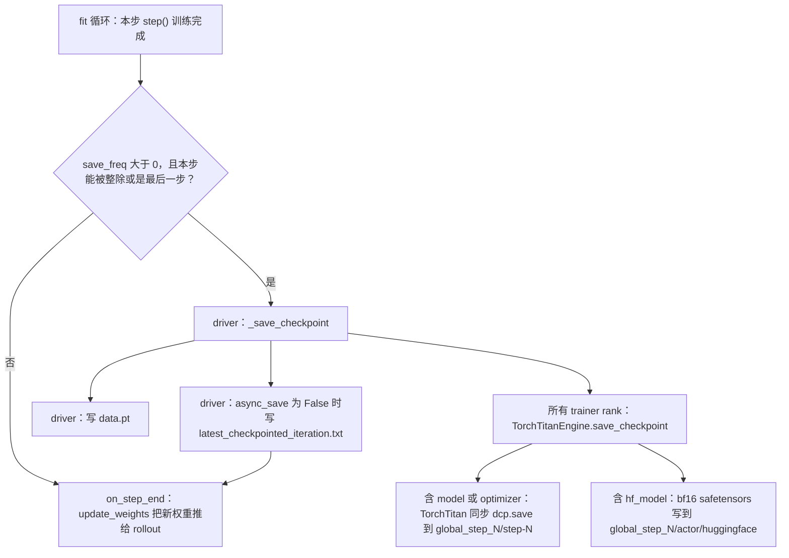

# ReTool TPU（TorchTitan + V1 `separate_async`）checkpoint 保存与恢复机制

状态：2026-11-04，只改文档。回答的问题：「`SAVE_FREQ=5` 是不是有点太紧密了？」，同时说明我们这条路径上的 checkpoint 怎么保存、怎么恢复。

- **代码基线**：tpu-main [`c4726400`](https://github.com/syangx39/verl-upstream/tree/c4726400d1816939adf78ea26dd25f3b8d662ea3)。`p3c-retool-25s-01/02` 用的 `CODE_REF=348bbff9` 只比 `c4726400` 多一个提交，改的全是 NAP launcher：`run_ray_jobset_v7x_nap.sh`、两个 JobSet 模板、`render.py` 和对应的测试（`git diff c4726400 348bbff9` 共 5 个文件）。下文涉及的 trainer、worker、engine、checkpoint 文件和 ReTool 脚本在两者之间完全相同。
- **TorchTitan 版本**：`google-pytorch/torchtitan@f880cc73`，依据是 [`Dockerfile.tpu` L46-L51](https://github.com/syangx39/verl-upstream/blob/c4726400d1816939adf78ea26dd25f3b8d662ea3/examples/tpu/gke/Dockerfile.tpu#L46-L51)。镜像 digest `d92a2b3d6667…` 同时出现在 [`tpu-ci-image.env` L1-L4](https://github.com/syangx39/verl-upstream/blob/c4726400d1816939adf78ea26dd25f3b8d662ea3/tests/special_tpu/gke/tpu-ci-image.env#L1-L4) 和 p3c 两次运行的 `run_record.json` 里。
- 代码链接都固定在上面两个 SHA。PR #17、PR #18 还没合入，引用时会单独标注「待合入」。

---

## 0. TL;DR

1. **实际跑的循环是 V1，不是 legacy 的 `ray_trainer.py`。** 脚本设置了 `trainer.use_v1=True` 和 `trainer.v1.trainer_mode=separate_async`，保存和恢复都在 [`verl/trainer/ppo/v1/trainer_base.py`](https://github.com/syangx39/verl-upstream/blob/c4726400d1816939adf78ea26dd25f3b8d662ea3/verl/trainer/ppo/v1/trainer_base.py#L504-L509) 里。触发条件是 `save_freq > 0`，并且当前步能被 `save_freq` 整除或者是最后一步。这和之前引用的 `ray_trainer.py` L1704 条件相同，只是 V1 **没有** ESI 到期前提前保存的分支。
2. **`p3c-retool-25s-02` 一个 checkpoint 也不会写。** 它的 `SAVE_FREQ=-1`，最后一步同样不写，GCS run 目录下也没有 `checkpoints/`。就算打开保存，当前脚本 `save_contents=['hf_model']` 加 `resume_mode=disable` 也只够「用导出的权重重新开一个 run」：优化器是新的，LR 调度和 `global_steps` 都从 0 开始，不是无损续跑。只把 `resume_mode` 改成 `auto` 也不行，加载时找不到 DCP 的 `step-N` 目录，会直接报 `FileNotFoundError`（见 §4、§7）。
3. **要能续跑，需要三个条件同时满足**：`save_contents` 包含 `model` 或 `optimizer`（触发 TorchTitan DCP 全状态保存，内容是 fp32 参数、AdamW m/v、LR scheduler 和 TorchTitan `train_state`）、`resume_mode=auto`、`default_local_dir` 放在 GCS Fuse 的 run 目录下。`extra` 在 TorchTitan 引擎里没有单独的含义；RNG 也不保存。
4. **在我们的 fork 里不要开 `async_save=True`。** TorchTitan 引擎根本没有读这个开关，DCP 仍然是同步写。它唯一的效果是让 trainer **跳过写 `latest_checkpointed_iteration.txt`**，结果 `resume_mode=auto` 会静默地从头训练。Askhat 的 `zyrnkte8` 保存只要约 55 s，但那次跑的是未公开的另一份代码，原因不明（§5、§8）。
5. **体量**：Qwen3-30B-A3B 共 30.53B 参数。HF 导出实测 **56.9 GiB**。DCP 全状态按 12 B/参数估算，每次约 **366 GB（341 GiB）**。另外，在我们的目录布局下 `max_actor_ckpt_to_keep` **删不掉旧的 DCP**，它只轮转 HF 导出（§3.3）。
6. **`SAVE_FREQ=5` 对全状态同步保存来说太密。** 用 Askhat 在 v5p 上测到的约 1,400 s/次（TPU7x 和 GCS Fuse 还没测），配合我们 TPU7x 64 卡约 342 s/步来算，SAVE_FREQ=5/10/20 的原始开销上界分别是 **82% / 41% / 20%**。`separate_async` 里有一部分保存时间会被 rollout 掩盖，Askhat 的净开销大约只有原始值的 1/3，但依然很贵。**建议先在 TPU7x 上实测一次保存耗时；在拿到实测值之前先用 `SAVE_FREQ=10`**（§9）。
7. **更正之前的说法**：「TorchTitan DCP 的优化器状态保存/加载没在 TPU 上验证过」这句话不准确。Askhat 在 v5p 上已经两次用全状态保存加 `resume_mode=auto` 成功续跑（`fcze3xlx → ci0k54pl`、`rq1p980n → hsodvfgr`）。真正还没验证的是 **TPU7x + 我们的 GCS Fuse 路径 + 我们的代码版本**。

---

## 0.1 直答三个核心疑问（附源码逐行对照与可执行脚本 [`ckpt_size_and_overhead.py`](ckpt_size_and_overhead.py)）

### 疑问 1：“TorchTitan 引擎已经实现了 DCP 方式保存和读取 optimizer 状态”是什么意思？

直接看 [`verl/workers/engine/torchtitan/transformer_impl.py`](../../verl/workers/engine/torchtitan/transformer_impl.py) 里的 `save_checkpoint`（L663–L714）和 `load_checkpoint`（L869–L896）源码：

```python
# verl/workers/engine/torchtitan/transformer_impl.py L663-L714
def save_checkpoint(
    self,
    local_path: str,               # trainer 传入: "<default_local_dir>/global_step_N/actor"
    hdfs_path: Optional[str] = None,
    global_step: int = 0,
    max_ckpt_to_keep: Optional[int] = None,
    **kwargs,
) -> None:
    if self._is_offload_param:
        for module in self.module:
            load_fsdp_model_to_gpu(module)

    save_contents = (
        list(self.checkpoint_config.save_contents)
        if self.checkpoint_config is not None and self.checkpoint_config.save_contents is not None
        else ["model", "optimizer", "extra"]
    )

    # 分支 1（仅针对 hf_model）：用 BaseCheckpointManager 轮转删除旧的 global_step_*/actor/huggingface
    hf_rotation = None
    if "hf_model" in save_contents and self._is_hf_checkpoint_writer(local_path):
        if self._hf_checkpoint_rotation is None:
            self._hf_checkpoint_rotation = BaseCheckpointManager(model=None, optimizer=None)
        hf_rotation = self._hf_checkpoint_rotation
        hf_rotation.ensure_checkpoint_capacity(max_ckpt_to_keep)

    # 分支 2（DCP 全状态保存）：只要 save_contents 含 "model" 或 "optimizer"，
    # 就调用 TorchTitan CheckpointManager.save()（底层是 PyTorch Distributed Checkpoint: torch.distributed.checkpoint.save）
    # 每个 rank 各自写出自己的 FSDP2/EP 分片到 <default_local_dir>/global_step_N/step-N/，
    # 里面同时包含：fp32 模型主参数 + AdamW exp_avg (m) + AdamW exp_avg_sq (v) + LR scheduler 状态 + train_state
    if any(k in save_contents for k in ("model", "optimizer")):
        parent_dir = os.path.dirname(local_path)   # 注意：这里是 ".../global_step_N"
        self.checkpointer.folder = parent_dir
        if max_ckpt_to_keep is not None:
            self.checkpointer.keep_latest_k = max_ckpt_to_keep
        self.checkpointer.save(curr_step=global_step)

    # 分支 3（HF 导出）：把参数 all-gather 后转成 bfloat16 写出到 <local_path>/huggingface/，不含 optimizer 状态
    if "hf_model" in save_contents:
        self._save_hf_checkpoint(local_path)

    torch.distributed.barrier()
    if hf_rotation is not None:
        hf_rotation.register_checkpoint(os.path.join(local_path, "huggingface"), max_ckpt_to_keep)
```

再看恢复时调用的 `load_checkpoint`（L869–L896）：

```python
# verl/workers/engine/torchtitan/transformer_impl.py L869-L896
def load_checkpoint(
    self,
    local_path: str,               # trainer 传入: "<default_local_dir>/global_step_N/actor"
    hdfs_path: Optional[str] = None,
    del_local_after_load: bool = False,
    **kwargs,
) -> None:
    parent_dir = os.path.dirname(local_path)       # ".../global_step_N"
    self.checkpointer.folder = parent_dir

    # 从路径提取步数 N，然后只调用 TorchTitan checkpointer.load(step=N) 读取 ".../global_step_N/step-N/"！
    # 注意：这里完全不看 load_contents，也完全不会去读 ".../global_step_N/actor/huggingface"！
    folder_name = os.path.basename(parent_dir)
    if folder_name.startswith("global_step_"):
        step = int(folder_name.split("global_step_")[1])
        self.checkpointer.load(step=step)
    else:
        self.checkpointer.load()
```

对照我们当前的启动脚本 [`run_qwen3_30b_a3b_dapo_torchtitan.sh`](run_qwen3_30b_a3b_dapo_torchtitan.sh)：

```bash
# examples/tpu/retool/run_qwen3_30b_a3b_dapo_torchtitan.sh L267, L345-L348
    "actor_rollout_ref.actor.checkpoint.save_contents=['hf_model']" \
    ...
    trainer.save_freq="${SAVE_FREQ}" \
    trainer.max_actor_ckpt_to_keep="${MAX_CKPT_TO_KEEP}" \
    trainer.resume_mode=disable \
    trainer.default_local_dir="${default_local_dir}" \
```

一目了然：
- 脚本只传了 `save_contents=['hf_model']`，所以只走了上面代码的**分支 3**（导出 `actor/huggingface` 的 `bf16` 推理权重），**跳过了分支 2**（没写 `global_step_N/step-N` 的 DCP 分片）。
- 如果只把 `resume_mode` 改成 `auto` 而不把 `'model','optimizer'` 加进 `save_contents`，恢复时 `load_checkpoint` 去找 `global_step_N/step-N/` 就会直接抛 `FileNotFoundError`。

### 疑问 2：“但还没在 TPU 上验证过”——核查后的准确边界是什么？

- **更正**：之前在聊天里说“没在 TPU 上验证过”不够准确——核查 Askhat 在 **TPU v5p** 上的 W&B 记录（已归档在 [`results/askhat-v5p/`](results/askhat-v5p/)）后确认，Askhat 的 6 个 RL run 全部用了 `save_contents=['model','optimizer','extra']` + `resume_mode=auto` + `save_freq=10`，并且已经成功从 `step-20`（`fcze3xlx → ci0k54pl`）和 `step-80`（`rq1p980n → hsodvfgr`）恢复续跑过两次。
- **真正还没实测的**是 **TPU v7x + 我们的 GCS Fuse（`/data/...`）挂载 + 我们当前分支代码**，而且读上面 `save_checkpoint` 代码（L697–L704）可以发现一个隐患：
  - 每次保存时 `self.checkpointer.folder` 都被改成当前步的 `.../global_step_N`；
  - TorchTitan 内部的 `_purge_stale_checkpoints()` 只会扫描 `os.listdir(self.checkpointer.folder)`（即 `global_step_N/` 内部），里面永远只有 1 个 `step-N/` 子目录；
  - 因此 **`max_actor_ckpt_to_keep=2` 只能轮转删除旧的 `actor/huggingface/`，旧的 `global_step_M/step-M/` DCP 目录永远不会被自动删除**（见 [`ckpt_size_and_overhead.py`](ckpt_size_and_overhead.py) 中的 `simulate_torchtitan_ckpt_layout()` 复现）。

### 疑问 3：“加上 Adam 状态后 checkpoint 会大很多，写入 GCS 要多久需要实测” & 为什么 `SAVE_FREQ=5` 太频繁？

运行 [`python3 examples/tpu/retool/ckpt_size_and_overhead.py`](ckpt_size_and_overhead.py) 可以直接算出 Qwen3-30B-A3B（`30,532,122,624` 参数）的体积对比与不同 `SAVE_FREQ` 的耗时开销：

```python
# 来自 examples/tpu/retool/ckpt_size_and_overhead.py 的精确计算：
total_params     = 30_532_122_624
hf_bf16_bytes    = total_params * 2   # 2 B/param (bf16 仅权重)        =  61.06 GB ( 56.87 GiB)
dcp_total_bytes  = total_params * 12  # 4 B fp32 权重 + 4 B m + 4 B v = 366.39 GB (341.22 GiB)，是 hf_model 的 6 倍！
```

- **体积差 6 倍**：只存 `hf_model`（`bf16`）是 **56.9 GiB**；加上 `fp32` 主权重和 AdamW 的一阶/二阶动量（`exp_avg`、`exp_avg_sq`）后，单次 DCP 全状态是 **341.2 GiB**（4 个 trainer host 各写约 **85.3 GiB**；若同时保留 `hf_model` 则单次合计约 **398 GiB**）。
- **为什么 `SAVE_FREQ=5` 太频繁**：
  - 在我们刚跑完 25 步的 TPU v7x `p3c-retool-25s-02` 上，纯训练速度约为 **342–364 s/步**（5 步约 28.5 分钟）。
  - 在 Askhat 的 TPU v5p 上，同步写一次 341 GiB 的 DCP 全状态耗时 **`timing_s/save_checkpoint ≈ 1,412 s`（约 23.5 分钟）**。
  - 如果设 `SAVE_FREQ=5`，每训练 28.5 分钟就要花 ~23.5 分钟写 checkpoint（原始保存耗时占训练步耗时的 **82.6%**，即便扣除 V1 异步 rollout 重叠后净开销仍达 **~30%**）；而改成 **`SAVE_FREQ=10` 或 `20`**，开销直接降到 1/2 到 1/4。因此完全赞同你的判断：**不需要 `SAVE_FREQ=5` 这么频繁，建议用 `SAVE_FREQ=10` 或 `20`**。

---

## 1. 实际运行的是哪个训练循环

| 环节 | 代码 |
| :--- | :--- |
| 脚本选择 V1 `separate_async`、TransferQueue 和 TorchTitan | [`run_qwen3_30b_a3b_dapo_torchtitan.sh` L227-L233](https://github.com/syangx39/verl-upstream/blob/c4726400d1816939adf78ea26dd25f3b8d662ea3/examples/tpu/retool/run_qwen3_30b_a3b_dapo_torchtitan.sh#L227-L233) |
| `use_v1` 选择 `TaskRunnerV1` | [`main_ppo.py` L233-L234](https://github.com/syangx39/verl-upstream/blob/c4726400d1816939adf78ea26dd25f3b8d662ea3/verl/trainer/main_ppo.py#L233-L234) |
| 按 `trainer_mode` 取 trainer 类，然后依次调用 `init()` 和 `fit()` | [`main_ppo.py` L183-L199](https://github.com/syangx39/verl-upstream/blob/c4726400d1816939adf78ea26dd25f3b8d662ea3/verl/trainer/main_ppo.py#L183-L199) |
| `PPOTrainerSeparateAsync` 没有覆盖 `fit`、`_save_checkpoint`、`_load_checkpoint`，直接用基类的实现 | [`trainer_separate_async.py` L44-L45](https://github.com/syangx39/verl-upstream/blob/c4726400d1816939adf78ea26dd25f3b8d662ea3/verl/trainer/ppo/v1/trainer_separate_async.py#L44-L45) |
| 基类的 `fit()` 循环 | [`trainer_base.py` L436-L560](https://github.com/syangx39/verl-upstream/blob/c4726400d1816939adf78ea26dd25f3b8d662ea3/verl/trainer/ppo/v1/trainer_base.py#L436-L560) |
| legacy `RayPPOTrainer`：已 deprecated，带 ESI 分支，**我们这条路径不会用到** | [`ray_trainer.py` L285-L286](https://github.com/syangx39/verl-upstream/blob/c4726400d1816939adf78ea26dd25f3b8d662ea3/verl/trainer/ppo/ray_trainer.py#L285-L286)、[L1692-L1712](https://github.com/syangx39/verl-upstream/blob/c4726400d1816939adf78ea26dd25f3b8d662ea3/verl/trainer/ppo/ray_trainer.py#L1692-L1712) |

---

## 2. 什么时候触发保存



- **触发条件**在 [`trainer_base.py` L504-L509](https://github.com/syangx39/verl-upstream/blob/c4726400d1816939adf78ea26dd25f3b8d662ea3/verl/trainer/ppo/v1/trainer_base.py#L504-L509)，`is_last_step` 的定义在 [L492](https://github.com/syangx39/verl-upstream/blob/c4726400d1816939adf78ea26dd25f3b8d662ea3/verl/trainer/ppo/v1/trainer_base.py#L492)。`save_freq <= 0` 时一次都不保存，**最后一步也不保存**。
- **保存会阻塞训练**：保存发生在 `marked_timer("step")` 内部（[L497-L512](https://github.com/syangx39/verl-upstream/blob/c4726400d1816939adf78ea26dd25f3b8d662ea3/verl/trainer/ppo/v1/trainer_base.py#L497-L512)），所以 `timing_s/step` 本身就包含了保存时间。它又排在 `on_step_end()` 之前，而 `on_step_end()` 里的 `update_weights` 负责把权重同步给 standalone rollout（[`trainer_separate_async.py` L392-L395](https://github.com/syangx39/verl-upstream/blob/c4726400d1816939adf78ea26dd25f3b8d662ea3/verl/trainer/ppo/v1/trainer_separate_async.py#L392-L395)）。结果是：保存期间 trainer 完全停下，rollout 继续用旧权重生成。
- **ESI 不适用于我们**：[`should_save_ckpt_esi`](https://github.com/syangx39/verl-upstream/blob/c4726400d1816939adf78ea26dd25f3b8d662ea3/verl/utils/checkpoint/checkpoint_manager.py#L262-L293) 只读 `MLP_CURRENT_CAPACITY_BLOCK_EXPIRATION_TIMESTAMP`（火山 MLP）和 `SAGEMAKER_CURRENT_CAPACITY_BLOCK_EXPIRATION_TIMESTAMP`（AWS）这两个环境变量，而且只有 legacy 和 experimental 的 trainer 会调用它，V1 不调用。我们的 launcher 和脚本也都没有设置这两个变量（仓库里只有测试代码会设）。
- **默认值**：框架默认 `save_freq: -1`，见 [`ppo_trainer.yaml` L173-L174](https://github.com/syangx39/verl-upstream/blob/c4726400d1816939adf78ea26dd25f3b8d662ea3/verl/trainer/config/ppo_trainer.yaml#L173-L174)。ReTool 脚本把 `SAVE_FREQ` 默认设为 `20`、`MAX_CKPT_TO_KEEP` 默认设为 `2`（[L210-L211](https://github.com/syangx39/verl-upstream/blob/c4726400d1816939adf78ea26dd25f3b8d662ea3/examples/tpu/retool/run_qwen3_30b_a3b_dapo_torchtitan.sh#L210-L211)），并通过 [L337-L340](https://github.com/syangx39/verl-upstream/blob/c4726400d1816939adf78ea26dd25f3b8d662ea3/examples/tpu/retool/run_qwen3_30b_a3b_dapo_torchtitan.sh#L337-L340) 传给 trainer。

---

## 3. 保存了什么，存在哪里

### 3.1 目录结构

`default_local_dir` 必须是一个共享路径，driver 和所有 trainer host 都要能看到同一份内容。原因有两个：DCP 是每个 rank 各写各的分片，而 tracker 和 `data.pt` 由 driver 写。

```text
${trainer.default_local_dir}/
├── latest_checkpointed_iteration.txt   # driver 写；async_save=True 时不写
├── global_step_10/
│   ├── step-10/                         # TorchTitan DCP（save_contents 含 model 或 optimizer 时）
│   │   ├── .metadata                    #   TorchTitan 靠这个文件判断 checkpoint 是否有效
│   │   └── 每个 rank 一个分片文件         #   PyTorch DCP 格式，按 rank 分片
│   ├── actor/huggingface/               # 只有 save_contents 含 hf_model 时才写（bf16 权重 + config/tokenizer）
│   ├── data.pt                          # driver 写的 StatefulDataLoader 状态
│   └── transfer_queue/                  # 需要 TransferQueue >= 0.1.9；我们的镜像是 0.1.8，所以不写
└── global_step_20/ ...
```

- **DCP 不在 `actor/` 下面。** 引擎把 TorchTitan 的 `folder` 设成 `dirname(local_path)`，也就是 `global_step_N`（[`transformer_impl.py` L696-L704](https://github.com/syangx39/verl-upstream/blob/c4726400d1816939adf78ea26dd25f3b8d662ea3/verl/workers/engine/torchtitan/transformer_impl.py#L696-L704)），TorchTitan 再在下面拼出 `step-N`（[`checkpoint.py` L1013-L1017](https://github.com/google-pytorch/torchtitan/blob/f880cc73725de77d892ecab888244e7718e5ad65/torchtitan/components/checkpoint.py#L1013-L1017)）。
- **`data.pt`、TransferQueue 状态和 tracker** 由 driver 写，见 [`trainer_base.py` L1029-L1059](https://github.com/syangx39/verl-upstream/blob/c4726400d1816939adf78ea26dd25f3b8d662ea3/verl/trainer/ppo/v1/trainer_base.py#L1029-L1059)。TransferQueue 状态还要先过 [`_tq_supports_checkpoint`](https://github.com/syangx39/verl-upstream/blob/c4726400d1816939adf78ea26dd25f3b8d662ea3/verl/trainer/ppo/v1/trainer_base.py#L112-L122) 的版本检查（要求 `>= 0.1.9`）。我们镜像里装的是 `TransferQueue = 0.1.8`（来自 `p3c-retool-25s-01` 的 `attempts/.../cluster/packages.json`），所以这一步被跳过。

### 3.2 `save_contents` 在 TorchTitan 引擎里实际是什么意思

引擎把 `save_contents` 只分成两类（[`transformer_impl.py` L681-L707](https://github.com/syangx39/verl-upstream/blob/c4726400d1816939adf78ea26dd25f3b8d662ea3/verl/workers/engine/torchtitan/transformer_impl.py#L681-L707)）：

| `save_contents` 里的值 | 引擎的实际行为 | 写出的内容 |
| :--- | :--- | :--- |
| `model` / `optimizer`（出现任意一个就算） | 调一次 `self.checkpointer.save(curr_step=N)`。TorchTitan 会保存它 `states` 里的**全部**状态，所以模型和优化器总是一起存，不能只存其中一个 | 见下一行 |
| （TorchTitan 的 `states`） | Trainer 构造 CheckpointManager 时传入 `{"train_state": self}`（[`trainer.py` L519-L532](https://github.com/google-pytorch/torchtitan/blob/f880cc73725de77d892ecab888244e7718e5ad65/torchtitan/trainer.py#L519-L532)），再补上 model、optimizer、dataloader、lr_scheduler（[`checkpoint.py` L477-L485](https://github.com/google-pytorch/torchtitan/blob/f880cc73725de77d892ecab888244e7718e5ad65/torchtitan/components/checkpoint.py#L477-L485)） | **fp32 主参数、AdamW `exp_avg` 和 `exp_avg_sq`、LR scheduler、TorchTitan `train_state`**（即 `step` 和 `ntokens_seen`，见 [L960-L965](https://github.com/google-pytorch/torchtitan/blob/f880cc73725de77d892ecab888244e7718e5ad65/torchtitan/trainer.py#L960-L965)）。dataloader 用的是 verl 的 [`NoOpDataLoader`](https://github.com/syangx39/verl-upstream/blob/c4726400d1816939adf78ea26dd25f3b8d662ea3/verl/workers/engine/torchtitan/utils.py#L39-L61)，状态是空字典 |
| `extra` | **引擎不检查这个值**，它没有任何单独效果 | — |
| `hf_model` | 调 `_save_hf_checkpoint`（[L734-L787](https://github.com/syangx39/verl-upstream/blob/c4726400d1816939adf78ea26dd25f3b8d662ea3/verl/workers/engine/torchtitan/transformer_impl.py#L734-L787)），把权重 gather 成完整的 bf16 张量，再复制源目录里的 config 和 tokenizer | `actor/huggingface/`，**只有权重**，可以直接给 vLLM 或下一个 run 当 `model.path` 用 |
| （没有对应的值） | RNG 不保存。`BaseCheckpointManager.get_rng_state` 虽然存在（[L196-L219](https://github.com/syangx39/verl-upstream/blob/c4726400d1816939adf78ea26dd25f3b8d662ea3/verl/utils/checkpoint/checkpoint_manager.py#L196-L219)），但 TorchTitan 引擎从不调用；TorchTitan 自己的 `states` 里也没有 RNG | — |

- 默认配置是 `save_contents: ['model','optimizer','extra']`，`load_contents: ${.save_contents}`，`async_save: False`（[`actor.yaml` L127-L142](https://github.com/syangx39/verl-upstream/blob/c4726400d1816939adf78ea26dd25f3b8d662ea3/verl/trainer/config/actor/actor.yaml#L127-L142)）。ReTool 脚本把它改成了只存 `['hf_model']`（[L259](https://github.com/syangx39/verl-upstream/blob/c4726400d1816939adf78ea26dd25f3b8d662ea3/examples/tpu/retool/run_qwen3_30b_a3b_dapo_torchtitan.sh#L259)）。
- **谁来写 HF 导出**（[`_is_hf_checkpoint_writer` L716-L732](https://github.com/syangx39/verl-upstream/blob/c4726400d1816939adf78ea26dd25f3b8d662ea3/verl/workers/engine/torchtitan/transformer_impl.py#L716-L732)）：路径在共享存储上时，只有全局 rank 0 写；路径以 `/tmp` 或 `/dev/shm` 开头时，**每个 host 的 local rank 0 各写一份**。

### 3.3 `max_actor_ckpt_to_keep` 管得住什么

- **HF 导出会被轮转。** 写之前先调 `ensure_checkpoint_capacity`，写完再调 `register_checkpoint`（[L687-L694](https://github.com/syangx39/verl-upstream/blob/c4726400d1816939adf78ea26dd25f3b8d662ea3/verl/workers/engine/torchtitan/transformer_impl.py#L687-L694)、[L709-L711](https://github.com/syangx39/verl-upstream/blob/c4726400d1816939adf78ea26dd25f3b8d662ea3/verl/workers/engine/torchtitan/transformer_impl.py#L709-L711)），删除逻辑本身在 [`checkpoint_manager.py` L166-L194](https://github.com/syangx39/verl-upstream/blob/c4726400d1816939adf78ea26dd25f3b8d662ea3/verl/utils/checkpoint/checkpoint_manager.py#L166-L194)。注意只删 `huggingface/` 子目录，`global_step_N/` 目录本身和里面的 `data.pt` 会留下。
- **DCP 不会被删除。** 引擎确实把 `keep_latest_k` 设成了 `max_ckpt_to_keep`（[L701-L702](https://github.com/syangx39/verl-upstream/blob/c4726400d1816939adf78ea26dd25f3b8d662ea3/verl/workers/engine/torchtitan/transformer_impl.py#L701-L702)）。但 TorchTitan 清理旧 checkpoint 时只会 `listdir(self.folder)`（[`checkpoint.py` L1146-L1162](https://github.com/google-pytorch/torchtitan/blob/f880cc73725de77d892ecab888244e7718e5ad65/torchtitan/components/checkpoint.py#L1146-L1162)），而 `self.folder` 每次都被设成当前这一步的 `global_step_N`，里面永远只有一个 `step-N`。所以旧的 `global_step_M/step-M` 永远不会被删，每保存一次就多出约 341 GiB。这一点在 [`REPRO_PLAN_TPU7X.md` L163](https://github.com/syangx39/verl-upstream/blob/c4726400d1816939adf78ea26dd25f3b8d662ea3/examples/tpu/retool/REPRO_PLAN_TPU7X.md#L163) 里也提到过，本文是对照代码确认的。

### 3.4 体量（Qwen3-30B-A3B）

| 项 | 数值 | 依据 |
| :--- | :--- | :--- |
| 参数量 | **30,532,122,624**（30.53B） | SFT 导出的 `model.safetensors.index.json` 里 `total_size = 61,064,245,248 B`，bf16 下除以 2 字节；再按 `config.json`（48 层、128 个 expert、hidden 2048、vocab 151936、不共享 embedding）逐项相加，结果完全一致 |
| HF 导出（bf16） | **56.89 GiB**（61,084,185,820 B，16 个分片） | 实测 `gs://ubench-logs/xiaotongyang/retool-v7x/runs/p2-retool-sft-01/checkpoint/global_step_372/huggingface/`（这次 SFT 只存了 `hf_model`，目录里没有 DCP） |
| DCP 全状态 | **约 366 GB（341 GiB）**，按 trainer 4 个 host 平摊约 85 GiB/host，32 个 rank 平摊约 10.7 GiB/rank | 估算值：fp32 参数 4 B + AdamW m 4 B + AdamW v 4 B，合计 12 B/参数。仓库里也写明 trainer 用的是「fp32 params + grads + Adam m/v」（[`run_qwen3_30b_a3b_torchtitan.sh` L12-L13](https://github.com/syangx39/verl-upstream/blob/c4726400d1816939adf78ea26dd25f3b8d662ea3/examples/tpu/grpo/run_qwen3_30b_a3b_torchtitan.sh#L12-L13)），梯度不进 checkpoint。**还没在存储上实测过** |
| 写 GCS Fuse 的参考速度 | 单 writer 约 100 MB/s | SFT 那 16 个 HF 分片的对象创建时间从 13:25:33 跨到 13:35:22，用了 589 s。那次 SFT 的代码版本是 `cfabaadab52e`，只能当一个量级参考 |

---

## 4. 调用链

**保存**

1. driver 端 [`_save_checkpoint` L981-L1063](https://github.com/syangx39/verl-upstream/blob/c4726400d1816939adf78ea26dd25f3b8d662ea3/verl/trainer/ppo/v1/trainer_base.py#L981-L1063)：先拼出 `global_step_N` 路径，读取 `max_actor_ckpt_to_keep`，调 `actor_rollout_wg.save_checkpoint(<..>/global_step_N/actor, ...)`，然后写 `data.pt`，按条件写 TransferQueue 状态，最后写 tracker 并触发 callback。
2. worker 端：[`ActorRolloutRefWorker.save_checkpoint` L744-L747](https://github.com/syangx39/verl-upstream/blob/c4726400d1816939adf78ea26dd25f3b8d662ea3/verl/workers/engine_workers.py#L744-L747) 用 `ONE_TO_ALL` 分发到所有 rank，转给 [`TrainingWorker.save_checkpoint` L465-L467](https://github.com/syangx39/verl-upstream/blob/c4726400d1816939adf78ea26dd25f3b8d662ea3/verl/workers/engine_workers.py#L465-L467)，再转给 `self.engine`。这个引擎由 `EngineRegistry` 创建，`checkpoint_config` 来自 `actor.checkpoint`（[L629-L636](https://github.com/syangx39/verl-upstream/blob/c4726400d1816939adf78ea26dd25f3b8d662ea3/verl/workers/engine_workers.py#L629-L636)）。在 `separate_async` 下 worker 类会被换成 `DetachActorWorker`（[L122-L134](https://github.com/syangx39/verl-upstream/blob/c4726400d1816939adf78ea26dd25f3b8d662ea3/verl/trainer/ppo/v1/trainer_separate_async.py#L122-L134)），但它没有重写 save/load，行为不变。
3. 引擎端 [`TorchTitanEngine.save_checkpoint` L663-L714](https://github.com/syangx39/verl-upstream/blob/c4726400d1816939adf78ea26dd25f3b8d662ea3/verl/workers/engine/torchtitan/transformer_impl.py#L663-L714) 调 TorchTitan 的 [`CheckpointManager.save` L707-L798](https://github.com/google-pytorch/torchtitan/blob/f880cc73725de77d892ecab888244e7718e5ad65/torchtitan/components/checkpoint.py#L707-L798)。
   - 引擎配置的是 `interval=1`，`async_mode` 不设，保持默认的 `disabled`（[L251-L257](https://github.com/syangx39/verl-upstream/blob/c4726400d1816939adf78ea26dd25f3b8d662ea3/verl/workers/engine/torchtitan/transformer_impl.py#L251-L257)），所以每次调用都会真的保存（[`_should_save` L1115-L1131](https://github.com/google-pytorch/torchtitan/blob/f880cc73725de77d892ecab888244e7718e5ad65/torchtitan/components/checkpoint.py#L1115-L1131)）。
   - 引擎调用时不传 `last_step`，所以不会走 TorchTitan「最后一步只存模型」的分支（[L739-L744](https://github.com/google-pytorch/torchtitan/blob/f880cc73725de77d892ecab888244e7718e5ad65/torchtitan/components/checkpoint.py#L739-L744)）。
   - 实际写盘是同步的 `dcp.save`（[L784-L790](https://github.com/google-pytorch/torchtitan/blob/f880cc73725de77d892ecab888244e7718e5ad65/torchtitan/components/checkpoint.py#L784-L790)、[L635-L640](https://github.com/google-pytorch/torchtitan/blob/f880cc73725de77d892ecab888244e7718e5ad65/torchtitan/components/checkpoint.py#L635-L640)），写完调 `_purge_stale_checkpoints`（L792），它在我们的布局下删不掉任何东西，见 §3.3。

**加载**（在 `init()` 阶段，见 §6）

1. [`PPOTrainer.init` L234-L244](https://github.com/syangx39/verl-upstream/blob/c4726400d1816939adf78ea26dd25f3b8d662ea3/verl/trainer/ppo/v1/trainer_base.py#L234-L244) 先调 `_setup()` 再调 `on_init_end()`。基类 `_setup` 的最后一步是让 rollout replica 进入 sleep，然后调 `_load_checkpoint()`（[L414-L416](https://github.com/syangx39/verl-upstream/blob/c4726400d1816939adf78ea26dd25f3b8d662ea3/verl/trainer/ppo/v1/trainer_base.py#L414-L416)）。
2. worker 端：[L739-L742](https://github.com/syangx39/verl-upstream/blob/c4726400d1816939adf78ea26dd25f3b8d662ea3/verl/workers/engine_workers.py#L739-L742) 转到 [L469-L471](https://github.com/syangx39/verl-upstream/blob/c4726400d1816939adf78ea26dd25f3b8d662ea3/verl/workers/engine_workers.py#L469-L471)，再转到 [`TorchTitanEngine.load_checkpoint` L869-L896](https://github.com/syangx39/verl-upstream/blob/c4726400d1816939adf78ea26dd25f3b8d662ea3/verl/workers/engine/torchtitan/transformer_impl.py#L869-L896)：把 `folder` 设成 `global_step_N`，从路径里解析出 N，调 `checkpointer.load(step=N)`。
3. TorchTitan [`load` L802-L913](https://github.com/google-pytorch/torchtitan/blob/f880cc73725de77d892ecab888244e7718e5ad65/torchtitan/components/checkpoint.py#L802-L913)：因为 N 不为 0，`model_only=False`，按 [`_states_to_load` L1042-L1070](https://github.com/google-pytorch/torchtitan/blob/f880cc73725de77d892ecab888244e7718e5ad65/torchtitan/components/checkpoint.py#L1042-L1070) 加载全部状态。如果 `step-N` 目录不存在，直接 `FileNotFoundError`（[L891-L894](https://github.com/google-pytorch/torchtitan/blob/f880cc73725de77d892ecab888244e7718e5ad65/torchtitan/components/checkpoint.py#L891-L894)）。另外，TorchTitan 引擎在加载时**完全不看 `load_contents`**。

---

## 5. `async_save`：在我们的 fork 里不能用

- 配置文档写明 `async_save` 「Only implemented for Megatron as of now」（[`config.py` L33-L49](https://github.com/syangx39/verl-upstream/blob/c4726400d1816939adf78ea26dd25f3b8d662ea3/verl/trainer/config/config.py#L33-L49)，[`actor.yaml` L141-L142](https://github.com/syangx39/verl-upstream/blob/c4726400d1816939adf78ea26dd25f3b8d662ea3/verl/trainer/config/actor/actor.yaml#L141-L142) 也是这么说的）。
- TorchTitan 确实支持 `disabled`、`async`、`async_with_pinned_mem` 三种 `async_mode`（[L314-L338](https://github.com/google-pytorch/torchtitan/blob/f880cc73725de77d892ecab888244e7718e5ad65/torchtitan/components/checkpoint.py#L314-L338)）。但异步模式需要在构造时就建好一个 gloo 进程组（[L506-L516](https://github.com/google-pytorch/torchtitan/blob/f880cc73725de77d892ecab888244e7718e5ad65/torchtitan/components/checkpoint.py#L506-L516)），而我们的引擎在构造配置里没设 `async_mode`（[L251-L257](https://github.com/syangx39/verl-upstream/blob/c4726400d1816939adf78ea26dd25f3b8d662ea3/verl/workers/engine/torchtitan/transformer_impl.py#L251-L257)）。所以**无论 `async_save` 设成什么，DCP 都是同步写的**。
- **`async_save=True` 唯一的实际效果是一个陷阱**：V1 trainer 会跳过写 `latest_checkpointed_iteration.txt`（[L1044-L1054](https://github.com/syangx39/verl-upstream/blob/c4726400d1816939adf78ea26dd25f3b8d662ea3/verl/trainer/ppo/v1/trainer_base.py#L1044-L1054)；单测 [`test_checkpoint_callback_on_cpu.py` L85-L93](https://github.com/syangx39/verl-upstream/blob/c4726400d1816939adf78ea26dd25f3b8d662ea3/tests/trainer/ppo/v1/test_checkpoint_callback_on_cpu.py#L85-L93) 明确断言了这一点）。没有 tracker 文件，[`find_latest_ckpt_path`](https://github.com/syangx39/verl-upstream/blob/c4726400d1816939adf78ea26dd25f3b8d662ea3/verl/utils/checkpoint/checkpoint_manager.py#L222-L259) 就返回 `None`，于是 `resume_mode=auto` 打印一句「Training from scratch」（[L894-L897](https://github.com/syangx39/verl-upstream/blob/c4726400d1816939adf78ea26dd25f3b8d662ea3/verl/trainer/ppo/v1/trainer_base.py#L894-L897)），**从头开始训练**。
- **Askhat 的 `zyrnkte8`**（`async_save=true`，保存约 55 s）：对比 W&B 上它和 `yrcsp4z6` 的完整 config，只有 `async_save`、几个路径和实验名不同。但两者的 Ray working_dir 包 hash 不一样，说明提交的是**不同的、未公开的代码**。我们的 fork、jialei777 的 tpu-main 和 PR115 分支的 TorchTitan 引擎都没有读 `async_save`。另外 `zyrnkte8` 从没续跑过，它的「可恢复性」完全没有验证。**结论：55 s 原因不明，需要找 Askhat 确认；不能当成我们这边的预期值。**
- **以后如果真要做异步保存**，需要三处改动：引擎把 `async_mode` 传给 TorchTitan；tracker 在 `maybe_wait_for_saving`（[L944-L965](https://github.com/google-pytorch/torchtitan/blob/f880cc73725de77d892ecab888244e7718e5ad65/torchtitan/components/checkpoint.py#L944-L965)）确认后台写完之后再写；评估 `async_with_pinned_mem` 需要的 host 内存（约等于每个 host 的 DCP 大小，85 GiB/host）。这些另开代码 PR，并且要做测试。
- **一个和 TPU 显存有关的风险（同步保存也有）**：TorchTitan 的 `ModelWrapper` 会缓存 state dict（[L72-L122](https://github.com/google-pytorch/torchtitan/blob/f880cc73725de77d892ecab888244e7718e5ad65/torchtitan/components/checkpoint.py#L72-L122)），由 state_dict hook 产生的张量是新分配的显存。Qwen3 用的是 fused `wqkv`，它的 split hook 会生成 fp32、全量复制的 q/k/v（[`transformer_impl.py` L962-L966](https://github.com/syangx39/verl-upstream/blob/c4726400d1816939adf78ea26dd25f3b8d662ea3/verl/workers/engine/torchtitan/transformer_impl.py#L962-L966)）。我们的引擎只在初始加载 HF 权重之后清过一次这个缓存（[L403-L416](https://github.com/syangx39/verl-upstream/blob/c4726400d1816939adf78ea26dd25f3b8d662ea3/verl/workers/engine/torchtitan/transformer_impl.py#L403-L416)、[L428-L429](https://github.com/syangx39/verl-upstream/blob/c4726400d1816939adf78ea26dd25f3b8d662ea3/verl/workers/engine/torchtitan/transformer_impl.py#L428-L429)），**第一次 DCP 保存或续跑加载之后不会再清**。按 48 × (4096 + 512 + 512) × 2048 ≈ 503M 个参数、每个 4 B 来估，每个 chip 会常驻约 1.9 GiB。这是估算，还没实测。

---

## 6. 恢复流程：哪些能恢复，哪些不能

- `resume_mode` 的三个取值都在 [`_load_checkpoint` L883-L941](https://github.com/syangx39/verl-upstream/blob/c4726400d1816939adf78ea26dd25f3b8d662ea3/verl/trainer/ppo/v1/trainer_base.py#L883-L941) 里处理：`disable` 直接返回；`auto` 读 tracker（[L889-L897](https://github.com/syangx39/verl-upstream/blob/c4726400d1816939adf78ea26dd25f3b8d662ea3/verl/trainer/ppo/v1/trainer_base.py#L889-L897)）；`resume_path` 要求 `resume_from_path` 里带 `global_step_`（[L898-L904](https://github.com/syangx39/verl-upstream/blob/c4726400d1816939adf78ea26dd25f3b8d662ea3/verl/trainer/ppo/v1/trainer_base.py#L898-L904)）。配置说明见 [`ppo_trainer.yaml` L183-L190](https://github.com/syangx39/verl-upstream/blob/c4726400d1816939adf78ea26dd25f3b8d662ea3/verl/trainer/config/ppo_trainer.yaml#L183-L190)。
- tracker 只在 worker 保存和 `data.pt` 都写完之后才会写，所以保存到一半崩溃时，`auto` 仍然会恢复到上一个完整的 checkpoint。

| 状态 | 能否恢复 | 依据 |
| :--- | :--- | :--- |
| 模型参数（fp32）、AdamW m/v、LR scheduler、TorchTitan `train_state` | ✅ 从 DCP 恢复 | §4 加载第 3 步 |
| verl 的 `global_steps` | ✅ 从目录名 `global_step_N` 解析 | [L908-L910](https://github.com/syangx39/verl-upstream/blob/c4726400d1816939adf78ea26dd25f3b8d662ea3/verl/trainer/ppo/v1/trainer_base.py#L908-L910) |
| dataloader 读到的位置 | ✅ 从 `data.pt` 恢复 | [L925-L931](https://github.com/syangx39/verl-upstream/blob/c4726400d1816939adf78ea26dd25f3b8d662ea3/verl/trainer/ppo/v1/trainer_base.py#L925-L931) |
| rollout（vLLM）权重 | ✅ 不从 checkpoint 读，而是 init 结束时由 trainer 重新推送 | [`on_init_end` L236-L240](https://github.com/syangx39/verl-upstream/blob/c4726400d1816939adf78ea26dd25f3b8d662ea3/verl/trainer/ppo/v1/trainer_separate_async.py#L236-L240) |
| 在途 prompt，以及 TransferQueue 里已生成但还没训练的轨迹 | ❌（TQ 0.1.8 低于要求的 0.1.9）。dataloader 已经越过这些 prompt，所以续跑时它们会被跳过；init 后会重新补 warmup prompt | [L1034-L1042](https://github.com/syangx39/verl-upstream/blob/c4726400d1816939adf78ea26dd25f3b8d662ea3/verl/trainer/ppo/v1/trainer_base.py#L1034-L1042)、[L653-L680](https://github.com/syangx39/verl-upstream/blob/c4726400d1816939adf78ea26dd25f3b8d662ea3/verl/trainer/ppo/v1/trainer_base.py#L653-L680)。Askhat `ci0k54pl` 的日志里能看到 `Added 128 warmup prompts after restoring 0 of 128 target prompt groups` |
| ReplayBuffer 的 staleness 等状态、RNG | ❌ | `replay_buffer.py` 没有 `state_dict`；RNG 见 §3.2 |
| W&B run | ❌ 会新开一个 run，id 也不同 | `wandb.init` 没传 `id` 或 `resume`（[`tracking.py` L76-L86](https://github.com/syangx39/verl-upstream/blob/c4726400d1816939adf78ea26dd25f3b8d662ea3/verl/utils/tracking.py#L76-L86)）。这和 Askhat 那两次续跑后 W&B id 变了一致 |
| `val_before_train` | ⚠️ 每次续跑都会**再完整跑一遍验证** | [L462-L472](https://github.com/syangx39/verl-upstream/blob/c4726400d1816939adf78ea26dd25f3b8d662ea3/verl/trainer/ppo/v1/trainer_base.py#L462-L472)。脚本默认 `VAL_BEFORE_TRAIN=True`（[L209](https://github.com/syangx39/verl-upstream/blob/c4726400d1816939adf78ea26dd25f3b8d662ea3/examples/tpu/retool/run_qwen3_30b_a3b_dapo_torchtitan.sh#L209)） |

续跑时保持 `TOTAL_TRAINING_STEPS`、batch、LR 等配置不变：LR scheduler 的配置是在构造时根据 `total_training_steps` 算出来的（[`transformer_impl.py` L214-L223](https://github.com/syangx39/verl-upstream/blob/c4726400d1816939adf78ea26dd25f3b8d662ea3/verl/workers/engine/torchtitan/transformer_impl.py#L214-L223)）。

---

## 7. 为什么我们当前的配置不能续跑

| 运行 | 关键设置（来自 GCS 上的 `job_spec.json` / `run_record.json`） | 结果 |
| :--- | :--- | :--- |
| `p3c-retool-25s-01` | `CODE_REF=348bbff9`，`SAVE_FREQ=5`，没设 `CKPTS_DIR`，于是走 [L101](https://github.com/syangx39/verl-upstream/blob/c4726400d1816939adf78ea26dd25f3b8d662ea3/examples/tpu/retool/run_qwen3_30b_a3b_dapo_torchtitan.sh#L101) 的默认值 `/tmp/checkpoint/${experiment_name}` | Step 5 保存成功：每个 trainer host 各往容器 `/tmp` 写了一份约 57 GiB 的 HF 导出，`timing_s/save_checkpoint=235.84 s`（同一步 `timing_s/step=323.40 s`）。Step 10 写第二份时触发 kubelet `ephemeral-storage` 驱逐，这一结论来自 PR #18 归档（`steps_1_to_9_summary.json` 的 [L5](https://github.com/syangx39/verl-upstream/blob/f6f3d7cd6b1c289d9b27744d2cdcbf37772241f0/examples/tpu/retool/results/p3c-retool-25s-01/steps_1_to_9_summary.json#L5) 和 [L65-L70](https://github.com/syangx39/verl-upstream/blob/f6f3d7cd6b1c289d9b27744d2cdcbf37772241f0/examples/tpu/retool/results/p3c-retool-25s-01/steps_1_to_9_summary.json#L65-L70)，待合入）。driver 日志里能看到的只有「node … received SIGTERM」 |
| `p3c-retool-25s-02` | 同样的代码，`SAVE_FREQ=-1`，`CKPTS_DIR=/data/xiaotongyang/retool-v7x/runs/p3c-retool-25s-02/checkpoints` | 一次都不保存。到 22:14 UTC（约 Step 24）为止，run 目录下没有 `checkpoints/` |

1. **`['hf_model']` 加 `resume_mode=disable`**（[L259](https://github.com/syangx39/verl-upstream/blob/c4726400d1816939adf78ea26dd25f3b8d662ea3/examples/tpu/retool/run_qwen3_30b_a3b_dapo_torchtitan.sh#L259)、[L339](https://github.com/syangx39/verl-upstream/blob/c4726400d1816939adf78ea26dd25f3b8d662ea3/examples/tpu/retool/run_qwen3_30b_a3b_dapo_torchtitan.sh#L339)）只能做到「用这份权重重开一个 run」：把 `MODEL_SRC_PATH`（[L76-L85](https://github.com/syangx39/verl-upstream/blob/c4726400d1816939adf78ea26dd25f3b8d662ea3/examples/tpu/retool/run_qwen3_30b_a3b_dapo_torchtitan.sh#L76-L85)）指到 `…/global_step_N/actor/huggingface`。代价是 AdamW 的 m/v 清零，LR warmup 重新开始，dataloader 从头读，`global_steps` 从 0 开始，在途数据丢失。
2. **只把 `resume_mode` 改成 `auto` 也不够。** tracker 能读到，但 `global_step_N/step-N` 不存在，TorchTitan 会直接抛 `FileNotFoundError`（§4）。
3. **`/tmp` 不能放 checkpoint**，有三个原因：
   - 它是容器本地盘，pod 删掉就没了，换个 attempt 也看不到；
   - TPU 7x 一个 host 只有大约 47 GB 临时盘（[`gke/README.md` L70](https://github.com/syangx39/verl-upstream/blob/c4726400d1816939adf78ea26dd25f3b8d662ea3/examples/tpu/gke/README.md#L70)、[`ray-jobset-v7x-nap.yaml` L18-L20](https://github.com/syangx39/verl-upstream/blob/c4726400d1816939adf78ea26dd25f3b8d662ea3/examples/tpu/gke/ray-jobset-v7x-nap.yaml#L18-L20)），而 HF 导出写 `/tmp` 时每个 host 都要写一份；
   - driver 和各个 rank 看到的不是同一份文件。
4. **应该用 GCS run 目录。** launcher 把 bucket 用 GCS FUSE 挂在每个 pod 的 `/data` 上（[launcher L101-L107](https://github.com/syangx39/verl-upstream/blob/c4726400d1816939adf78ea26dd25f3b8d662ea3/examples/tpu/gke/run_ray_jobset_v7x_nap.sh#L101-L107)、[slice yaml L106-L117](https://github.com/syangx39/verl-upstream/blob/c4726400d1816939adf78ea26dd25f3b8d662ea3/examples/tpu/gke/ray-jobset-v7x-nap-slice.yaml#L106-L117)），容器里的 `RUN_DIR=/data/<RUN_ROOT>/<RUN_NAME>` 对应 `gs://<bucket>/<RUN_ROOT>/<RUN_NAME>`（[L180-L184](https://github.com/syangx39/verl-upstream/blob/c4726400d1816939adf78ea26dd25f3b8d662ea3/examples/tpu/gke/run_ray_jobset_v7x_nap.sh#L180-L184)）。`JOBENV_*` 里的 `@RUN_DIR@` 会被替换成这个路径，同时导出 `VERL_NAP_RUN_DIR`（[L264-L268](https://github.com/syangx39/verl-upstream/blob/c4726400d1816939adf78ea26dd25f3b8d662ea3/examples/tpu/gke/run_ray_jobset_v7x_nap.sh#L264-L268)、[L281](https://github.com/syangx39/verl-upstream/blob/c4726400d1816939adf78ea26dd25f3b8d662ea3/examples/tpu/gke/run_ray_jobset_v7x_nap.sh#L281)）。我们的 bucket 是 `ubench-logs`，`RUN_ROOT=xiaotongyang/retool-v7x/runs`。PR #18（待合入）已经把默认值改成 `${VERL_NAP_RUN_DIR}/checkpoints`（[`f6f3d7cd` L101-L109](https://github.com/syangx39/verl-upstream/blob/f6f3d7cd6b1c289d9b27744d2cdcbf37772241f0/examples/tpu/retool/run_qwen3_30b_a3b_dapo_torchtitan.sh#L101-L109)）。
5. **长 run 其实非续跑不可。** 集群从 pod ready 开始计时，限时 120 或 180 分钟（[launcher L137-L142](https://github.com/syangx39/verl-upstream/blob/c4726400d1816939adf78ea26dd25f3b8d662ea3/examples/tpu/gke/run_ray_jobset_v7x_nap.sh#L137-L142)；预约命名空间 `r-*` 按预约窗口算）。400 步按 342 s/步约需 38 h，必须拆成多次运行。launcher 的 JobSet 重启和 Kueue 重新准入都是「从头重新跑 job」（[L46-L48](https://github.com/syangx39/verl-upstream/blob/c4726400d1816939adf78ea26dd25f3b8d662ea3/examples/tpu/gke/run_ray_jobset_v7x_nap.sh#L46-L48)），只有 checkpoint 放在同一个 GCS 目录、并且 `resume_mode=auto`，重跑才能接着上次的进度。

---

## 8. Askhat 在 v5p 上的配置和实测数据（W&B `google-trellis/verl-torchtpu-grpo-test`）

6 个 RL run 的共同配置：`trainer.save_freq=10`；`save_contents` 和 `load_contents` 都是 `['model','optimizer','extra']`；`max_actor_ckpt_to_keep=2`；`resume_mode=auto`；`default_local_dir=/data/aaskhat/checkpoint/<experiment>`；trainer 用 16 颗 v5p（4 节点 × 4）。

| run | 步数范围 | `async_save` | `timing_s/save_checkpoint` 均值（每次） |
| :--- | :--- | :--- | :--- |
| [`fcze3xlx`](https://wandb.ai/google-trellis/verl-torchtpu-grpo-test/runs/fcze3xlx) | 1–23（崩溃） | false | 1390.2 s（2 次） |
| [`ci0k54pl`](https://wandb.ai/google-trellis/verl-torchtpu-grpo-test/runs/ci0k54pl) | 21–150，从 `fcze3xlx` 的 step 20 **续跑** | false | 1429.4 s（13 次） |
| [`rq1p980n`](https://wandb.ai/google-trellis/verl-torchtpu-grpo-test/runs/rq1p980n) | 1–80 | false | 1411.8 s（8 次） |
| [`hsodvfgr`](https://wandb.ai/google-trellis/verl-torchtpu-grpo-test/runs/hsodvfgr) | 81–150，从 `rq1p980n` 的 step 80 **续跑** | false | 1413.6 s（7 次） |
| [`yrcsp4z6`](https://wandb.ai/google-trellis/verl-torchtpu-grpo-test/runs/yrcsp4z6) | 保存到 step 110 | false | 1398.9 s（11 次） |
| [`zyrnkte8`](https://wandb.ai/google-trellis/verl-torchtpu-grpo-test/runs/zyrnkte8) | 保存到 step 150 | **true** | 55.2 s（46–60 s，15 次）。代码不同，原因不明（§5） |

- **续跑的证据**：`ci0k54pl` 的 W&B 输出日志开头就是 `Training Progress: 20/150`，紧接着是 `Added 128 warmup prompts after restoring 0 of 128 target prompt groups`，说明 DCP 全状态加载成功、TransferQueue 状态没有恢复。`hsodvfgr` 的 W&B history 从 step 81 开始。至于优化器状态是否逐位一致地恢复，没有单独检查过。
- **保存期间 rollout 掩盖了多少**：根据存档的 W&B history（`fcze3xlx`、`ci0k54pl`、`hsodvfgr`，共 20 次保存）估算：保存后的下一步只花 187–479 s，而这三个 run 普通步的中位数约 1,260 s，原因是保存期间 standalone rollout 一直在生成。因此每次保存的净墙钟开销约为 **290–660 s**（三个 run 各自的均值），20 次总体均值约 510 s，大约是原始保存时长的 1/3。这是估算，普通步时长本身波动很大。
- 这些都是 **v5p** 上的数，Askhat 当时的代码版本和挂载方式也和我们不同，**在 TPU7x + 我们的 GCS Fuse 上需要重新测**。

---

## 9. SAVE_FREQ 怎么取舍

输入：
- **我们 TPU7x 64 卡的步时长**：约 **342 s/步**。来自 `p3c-retool-25s-02` 的 driver 日志：tqdm 在 Step 1 时显示 `14:39`，Step 24 时显示 `2:25:42`，(8742 − 879) / 23 ≈ 342 s。trainer 是 1 个 2x2x4 slice（4 host × 4 chip），另外 3 个 slice 跑 rollout。日志里偶数步要等约 260–500 s 的 `gen`，奇数步样本已经准备好，所以 trainer 有相当一部分时间是空闲的。
- **保存一次要多久**：全状态同步保存按 Askhat v5p 实测的约 1,400 s 计算（TPU7x **还没测**）；只存 HF 导出到 `/tmp` 是我们 TPU7x 唯一的实测值，235.84 s（不能续跑）。

| SAVE_FREQ | 保存周期 | 全状态同步、原始开销上界（1,400 s/次） | 按 Askhat 净开销估（≈510 s/次，只看量级） | 只存 HF 到 `/tmp`（236 s/次，TPU7x 实测，**不能续跑**） | 被抢占时最多丢多少 |
| :---: | :---: | :---: | :---: | :---: | :---: |
| 5 | 1,709 s | **82%** | 30% | 14% | 5 步 ≈ 28.5 min |
| 10 | 3,419 s | **41%** | 15% | 6.9% | 10 步 ≈ 57 min |
| 20 | 6,837 s | **20%** | 7.5% | 3.4% | 20 步 ≈ 114 min |

开销 = 每次保存时长 ÷ (SAVE_FREQ × 342 s)。被抢占时的实际损失还要再加上重启成本：排队、拉起节点、staging 模型、编译、warmup，以及续跑时再跑一遍的 `val_before_train`。

- **结论**：如果 TPU7x 上全状态保存接近 1,400 s，`SAVE_FREQ=5` 显然太密，即使按 1/3 掩盖算也要多花约 30% 的墙钟时间。按 180 分钟窗口里约 150 分钟有效训练、342 s/步算，一个窗口大约跑 26 步，SAVE_FREQ=5 要保存 5 次，光保存就会吃掉一大半时间。**建议先用 `SAVE_FREQ=10`**，和 Askhat 保持一致。等 TPU7x 的实测数出来再调：如果每次 ≤ 3 min（SAVE_FREQ=5 时上界约 10%），可以考虑改成 5；如果仍然在 20 min 量级，就保持 10–20，并考虑让最后一次保存尽量贴近限时之前（V1 没有 ESI 机制，需要另外实现）。
- **GB200 64 卡**（PR #17，待合入）：墙钟约 83.7 s/步，而且 trainer 几乎不等 rollout（`timing_s/gen` 均值 0.038 s，见 [`gb200/README.md` L507](https://github.com/syangx39/verl-upstream/blob/dfdaea2c63fccfd9f058ea42a70f7481f2c0429d/examples/tpu/retool/gb200/README.md#L507)），所以保存时间不会被掩盖，开销是全额的。被抢占时最多丢 7 / 14 / 28 min（SAVE_FREQ=5/10/20）。GB200 上的保存耗时还没测。

---

## 10. 建议的改动和验证步骤（只是提案，本 PR 不改脚本）

脚本 `run_qwen3_30b_a3b_dapo_torchtitan.sh` 的改动：

1. [L259](https://github.com/syangx39/verl-upstream/blob/c4726400d1816939adf78ea26dd25f3b8d662ea3/examples/tpu/retool/run_qwen3_30b_a3b_dapo_torchtitan.sh#L259)：`save_contents` 改为可配置，默认 `['model','optimizer','extra']`。如果还需要给 vLLM 或评测用的 HF 权重，再加上 `hf_model`，代价是每次多 57 GiB 和一次导出时间。
2. [L339](https://github.com/syangx39/verl-upstream/blob/c4726400d1816939adf78ea26dd25f3b8d662ea3/examples/tpu/retool/run_qwen3_30b_a3b_dapo_torchtitan.sh#L339)：`trainer.resume_mode="${RESUME_MODE:-auto}"`。
3. [L101](https://github.com/syangx39/verl-upstream/blob/c4726400d1816939adf78ea26dd25f3b8d662ea3/examples/tpu/retool/run_qwen3_30b_a3b_dapo_torchtitan.sh#L101)：采用 PR #18 的默认值 `${VERL_NAP_RUN_DIR}/checkpoints`。另外，在 NAP 上如果 `SAVE_FREQ > 0` 而目录落在 `/tmp`，直接报错退出。
4. [L210](https://github.com/syangx39/verl-upstream/blob/c4726400d1816939adf78ea26dd25f3b8d662ea3/examples/tpu/retool/run_qwen3_30b_a3b_dapo_torchtitan.sh#L210)：`SAVE_FREQ` 默认值改成 `10`；`MAX_CKPT_TO_KEEP=2` 保持不变。
5. 显式写上 `actor_rollout_ref.actor.checkpoint.async_save=False`，并在注释里说明原因（§5）。
6. 续跑的那次运行设 `VAL_BEFORE_TRAIN=False`（[L209](https://github.com/syangx39/verl-upstream/blob/c4726400d1816939adf78ea26dd25f3b8d662ea3/examples/tpu/retool/run_qwen3_30b_a3b_dapo_torchtitan.sh#L209)），省掉重复的验证。
7. launcher 设 `JOBSET_MAX_RESTARTS ≥ 1` 和/或 `ALLOW_REQUEUE ≥ 1`（[L118-L122](https://github.com/syangx39/verl-upstream/blob/c4726400d1816939adf78ea26dd25f3b8d662ea3/examples/tpu/gke/run_ray_jobset_v7x_nap.sh#L118-L122)、[L152-L155](https://github.com/syangx39/verl-upstream/blob/c4726400d1816939adf78ea26dd25f3b8d662ea3/examples/tpu/gke/run_ray_jobset_v7x_nap.sh#L152-L155)）。这样自动重跑时就会用同一个 `RUN_DIR`，并通过 `auto` 接着上次进度。手动重跑时用同一个 `RUN_NAME`，或者显式给出同一个 `CKPTS_DIR`。

需要单独提的代码 PR：
- 清理 DCP：在 `TorchTitanEngine.save_checkpoint` 里像 HF 导出那样，用 `BaseCheckpointManager` 轮转 `global_step_*/step-*`，并补一个和 `test_torchtitan_hf_ckpt_rotation_on_cpu.py` 类似的 CPU 测试；或者先用外部脚本清理。
- 中长期：在 RUN_LIMIT 到期前主动保存一次；真正接上 TorchTitan 的异步保存（§5）。

**长跑前先做 save → kill → resume 冒烟测试**：

1. 跑一个短任务：`TOTAL_TRAINING_STEPS=6 SAVE_FREQ=2 TEST_FREQ=-1 VAL_BEFORE_TRAIN=False`，使用全状态的 `save_contents`、`RESUME_MODE=auto`、`JOBENV_CKPTS_DIR=@RUN_DIR@/checkpoints`。需要记录：
   - `timing_s/save_checkpoint`，也就是 TPU7x 上的保存耗时；
   - `gcloud storage du -s …/global_step_2/step-2`，核对 341 GiB 的估算；
   - 保存期间节点临时盘的用量，因为 GCS Fuse 是否会先把文件暂存到本地盘还不清楚；
   - 保存前后 HBM 的占用。
2. 等 tracker 变成 4 以后停掉 JobSet，然后用同一个 `RUN_NAME` 或 `CKPTS_DIR` 重新启动，`TOTAL_TRAINING_STEPS` 保持 6。预期日志：
   - `Resuming from …/global_step_4`（[L910](https://github.com/syangx39/verl-upstream/blob/c4726400d1816939adf78ea26dd25f3b8d662ea3/verl/trainer/ppo/v1/trainer_base.py#L910)）；
   - TorchTitan 的 `Loading the checkpoint from …/step-4`；
   - tqdm 从 `4/6` 开始；
   - `restoring 0 of 128`（TQ 0.1.8，属于预期）；
   - Step 5 的 `actor/lr` 和 `actor/grad_norm` 落在合理范围。
3. 两步都通过之后，再启动长 run。

---

## 11. 证据边界和尚未验证的项

- **还没实测**：TPU7x + GCS Fuse 上一次全状态 DCP 保存要多久、实际有多大（341 GiB 是估算）；续跑时加载要多久；保存后常驻 HBM 增加多少（约 1.9 GiB/chip 是估算）。
- **存储风险**：如果 GCS Fuse 会把整个文件先暂存到本地临时盘（取决于 gcsfuse 版本和配置，我们没核实），每个 host 约 85 GiB 的 DCP 会超过 TPU 7x 约 47 GB 的临时盘。冒烟测试时必须盯一下这项。
- **`zyrnkte8` 的 55 s** 是在不同代码上跑出来的，原因不明，需要找 Askhat 确认。
- **TorchTitan 版本**是按 `Dockerfile.tpu` 加 digest 推断的，没有进镜像核对；TQ 版本取自 `p3c-retool-25s-01` 的 `packages.json`，和 25s-02 是同一个镜像。
- **25s-01 Step 10 被 ephemeral-storage 驱逐**这个结论取自 PR #18 的归档；直接读 driver 日志只能看到「received SIGTERM」。
- **DCP 不会被清理**是读代码得出的结论，没有在存储上观察到。
- **Askhat 的续跑**只能确认 run 接上了，没有验证优化器状态逐位一致；那批 run 是 v5p，代码也不是我们这份。
