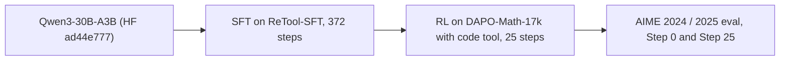
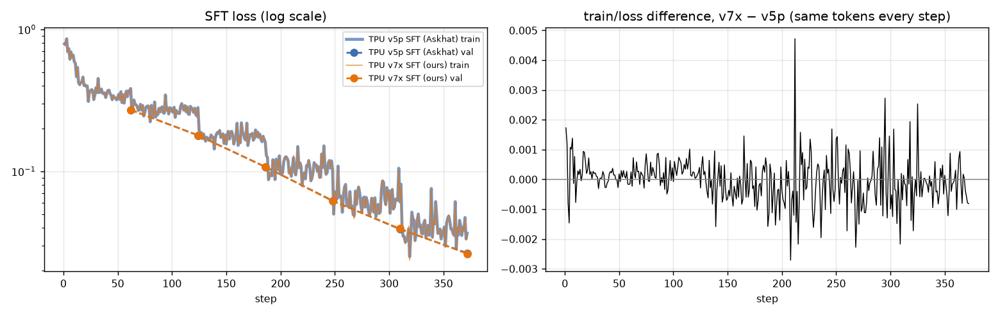
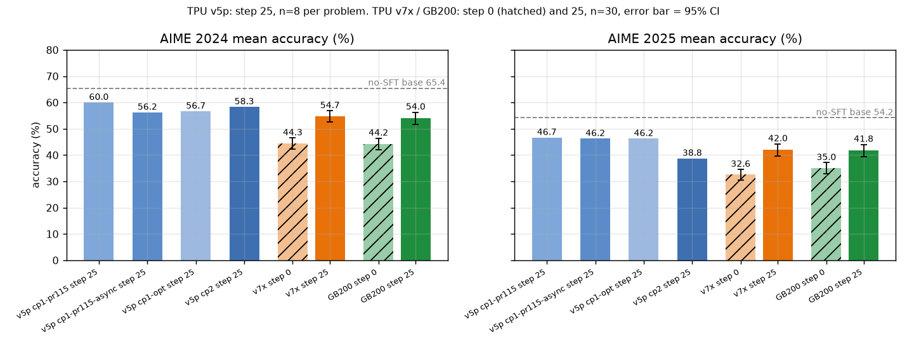
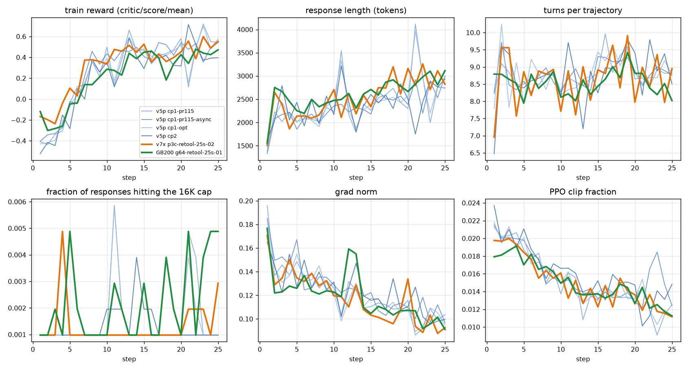
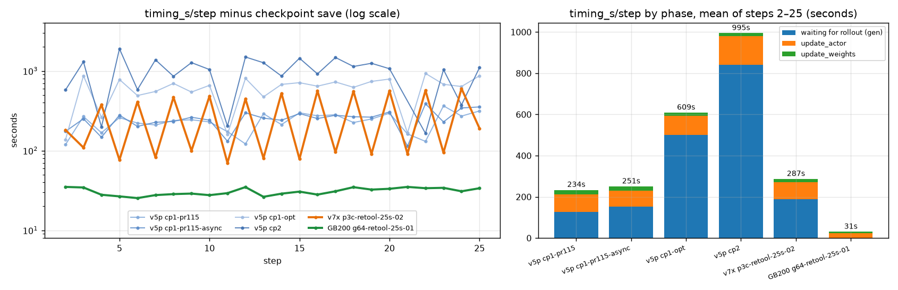

# ReTool RL on Qwen3-30B-A3B: TPU v5p vs. TPU v7x vs. GB200

Owner: @syangx39 · TPU v5p reference runs: Askhat · Data snapshot: [`repro_guide/data/`](repro_guide/data/)
(fetched 2026-11-06)

This guide reproduces one RL recipe on three platforms and compares them apples to apples. It only uses files
outside `exp/` and `logs/`; those two folders keep the bring-up history and are not needed here.

## 0. Overview

**Recipe.** ReTool-style multi-turn tool-use RL ([arXiv:2504.11536](https://arxiv.org/abs/2504.11536)) with the
`examples/tpu/retool` recipe of verl (from
[jialei777/verl-upstream#108](https://github.com/jialei777/verl-upstream/pull/108)): `Qwen/Qwen3-30B-A3B` (MoE,
30.5B total / 3.3B active parameters) is first fine-tuned on ReTool-SFT (cold start, 372 steps), then trained with
GRPO-style RL on DAPO-Math-17k while it can call a Python code interpreter (up to 16 turns, 16K response tokens), and
evaluated on AIME 2024 and AIME 2025. The trainer is TorchTitan, the rollout is vLLM, and the two run on separate
accelerators (verl V1 `separate_async` trainer).

**The three runs** (25 RL steps each). Askhat's four TPU v5p runs are the reference; ours are one TPU v7x run and one
GB200 run. The v5p runs went to 150 steps; only their first 25 steps are compared.



<!-- BEGIN AUTO-GENERATED summary (make_report.py) -->
| | TPU v5p (Askhat) | TPU v7x (ours) | GB200 (ours) |
| --- | --- | --- | --- |
| Runs | 4 (cp1-pr115, cp1-pr115-async, cp1-opt, cp2) | 1 (p3c-retool-25s-02) | 1 (g64-retool-25s-01) |
| Trainer + rollout accelerators | 16 + 32 chips (cp2: 16 + 16 → 32) | 16 + 48 chips | 16 + 48 GPUs |
| Validation samples per problem | 8 | 30 | 30 |
| AIME 2024 accuracy, Step 0 | not evaluated | 44.33% | 44.22% |
| AIME 2024 accuracy, Step 25 | 56.25% to 60.00% | 54.67% | 54.00% |
| AIME 2025 accuracy, Step 0 | not evaluated | 32.56% | 35.00% |
| AIME 2025 accuracy, Step 25 | 38.75% to 46.67% | 42.00% | 41.78% |
| Train reward, mean of steps 21–25 | +0.479 to +0.483 | +0.516 | +0.432 |
| Observed wall clock per step, mean of steps 2–25 (s) | 236 to 998 | 337 | 73 |
| … minus measured TensorBoard writing (s, arithmetic, not a measured step time) | no TensorBoard logger | 291 | 33 |
<!-- END AUTO-GENERATED summary -->

**Same in all runs** (what was checked, and how, is in §3):

- Every algorithm setting in the W&B resolved config: GRPO advantages, DAPO clip-higher 0.2 / 0.28, token-mean loss,
  no KL, 64 prompts × 16 responses per step, one optimizer step per batch, constant LR 2e-6, sampling temperature 1,
  16K response cap, 16 turns, thinking on, async trainer with staleness ≤ 4 (§3.1). This is the resolved config,
  not verified runtime behaviour: in our two runs `rollout_correction.rollout_is` / threshold never reach the
  actor (§3.1), and for Askhat's runs the code is not recorded.
- The reward function and dataset code, as far as can be checked: `retool_tpu.py` and `retool_dataset_utils.py`
  are byte-identical in Askhat's merged recipe and in the code of our two runs, and all six runs log the same reward
  function path and name. Askhat's runs used local changes whose commit is not recorded, so this does not prove that
  his runs loaded the same code (§3.2).
- The input files: Askhat's runs read `/data/jialei/` (`gs://torchprime/jialei/`), ours read a byte-identical copy
  (same MD5); their rows equal the pinned Hugging Face revisions (§1.3).
- The SFT recipe: same script settings and the same token count at each of the 372 steps (23.8M tokens in total);
  the losses of Askhat's SFT and ours agree within 0.005 at every step (§1.4).

**Different** (by design or not controlled):

- Accelerators, parallelism, kernels and memory settings (§3.1 "System adaptations").
- The SFT checkpoint: v5p starts from Askhat's SFT (matched by its path name, not by hash); TPU v7x and GB200 start
  from the same TPU v7x SFT checkpoint (same bytes, verified by hash on every GB200 node).
- Evaluation: Askhat's runs evaluate 8 samples per problem and skip Step 0; ours evaluate 30 samples per problem at
  Step 0 and Step 25.
- Code base: Askhat's runs used the `jialei777/verl-upstream` TPU code with local changes (the commit is not
  recorded in W&B); the TPU v7x run uses this repository at `348bbff9`; the GB200 run uses an upstream-verl branch
  with the ReTool example ported (§2.2).

**Conclusions** (details and caveats in §4.5):

1. **TPU v7x and GB200 end close: a positive, preliminary parity signal.** From the same SFT checkpoint, the Step 25
   accuracies differ by +0.67 pp (AIME 2024) and +0.22 pp (AIME 2025), and both runs improve by about +10 pp on
   AIME 2024 and +7 to +9 pp on AIME 2025. No difference was detected on this fixed problem set, but that does not
   show the two are equivalent: there is one formal run per platform, and the intervals cover only the sampling of
   responses, not run-to-run (training seed) variance. Whether the training distributions match is still open.
2. **Both are close to Askhat's TPU v5p runs.** Reward, response length, turns, gradient norm and clip fraction
   follow the band of the four v5p runs. At Step 25, AIME 2025 is inside the v5p range and AIME 2024 is 1.6 to
   6.0 pp below it. Askhat's runs and ours started from different SFT checkpoints, v5p has no Step 0 evaluation and
   his run code is not recorded, so this gap cannot be attributed to the hardware.
3. **Speed.** Observed wall clock per step: GB200 73 s, TPU v7x 337 s (most of it waiting for the rollout), and
   236 s for Askhat's fastest v5p configuration on 48 chips. Our two runs spent 40 s and 47 s per step writing
   TensorBoard to the GCS FUSE mount; how much of that a local log directory would save is not measured yet. These
   are different chip generations, counts and rollout layouts, so this compares configurations, not chips.

**Files this guide uses** (all at the top of `examples/tpu/retool/` unless noted):

| File | Role |
| --- | --- |
| [`run_qwen3_30b_a3b_sft_torchtitan.sh`](run_qwen3_30b_a3b_sft_torchtitan.sh) | SFT recipe (TPU) |
| [`run_qwen3_30b_a3b_dapo_torchtitan.sh`](run_qwen3_30b_a3b_dapo_torchtitan.sh) | RL recipe (TPU v5p and v7x) |
| [`gb200/run_qwen3_30b_a3b_dapo_torchtitan_gb200.sh`](gb200/run_qwen3_30b_a3b_dapo_torchtitan_gb200.sh) | RL recipe (GB200) |
| [`retool_tpu.py`](retool_tpu.py), [`retool_dataset_utils.py`](retool_dataset_utils.py) | Reward function, dataset class and prompt formatting (all platforms) |
| [`sandbox_fusion_tools.py`](sandbox_fusion_tools.py), [`sandbox_fusion_server.py`](sandbox_fusion_server.py), [`sandbox_fusion_tool_config_tpu.yaml`](sandbox_fusion_tool_config_tpu.yaml) | Code-interpreter tool and its local sandbox server (all platforms) |
| [`prepare_retool_data.py`](prepare_retool_data.py) | Downloads and checks the datasets (§1.3) |
| [`../gke/run_ray_jobset_v7x_nap.sh`](../gke/run_ray_jobset_v7x_nap.sh), [`../gke/Dockerfile.tpu`](../gke/Dockerfile.tpu) | TPU v7x launcher and image |
| [`../grpo/run_grpo_v5p_nap.sh`](../grpo/run_grpo_v5p_nap.sh) | TPU v5p launcher (used by Askhat) |
| [`gb200/run_ray_jobset_gb200.sh`](gb200/run_ray_jobset_gb200.sh), [`gb200/Dockerfile.gb200.torchtitan`](gb200/Dockerfile.gb200.torchtitan) | GB200 launcher and image |
| [`rollout_mask_audit.py`](rollout_mask_audit.py), [`step_timing_breakdown.py`](step_timing_breakdown.py) | Optional checks of a finished run (§4.6) |
| [`repro_guide/`](repro_guide/) | Data snapshot, `fetch_runs.py` and `make_report.py` behind every table and figure here |

## 1. TPU v7x setup

### 1.1 Image

| | |
| --- | --- |
| Dockerfile | [`examples/tpu/gke/Dockerfile.tpu`](../gke/Dockerfile.tpu) (base `rayproject/ray:2.56.0-py312`) |
| Artifact Registry | [`us-west2-docker.pkg.dev/tpu-pytorch/raycluster/verl-tpu`](https://pantheon.corp.google.com/artifacts/docker/tpu-pytorch/us-west2/raycluster/verl-tpu?project=tpu-pytorch) |
| RL run image | tag `v20261006-tsync1006`, digest `sha256:d92a2b3d6667584d67ea51874a721228a96c799263ab40f4aee168680476f64e` (the TPU CI image, [`tpu-ci-image.env`](../../../tests/special_tpu/gke/tpu-ci-image.env)) |
| SFT run image | tag `v20261001-tsync990787257`, digest `sha256:dcece4bc3813359450f48d4523e5bd78e3139dc441a88b5c2e4d638caa054cbe` |

Use these prebuilt images; this guide does not give a rebuild command.

> [!WARNING]
> Do not rebuild `Dockerfile.tpu` as it is with your own credentials and push the result. It takes an access token
> and a GitHub token as build arguments, keeps the access token in an `ENV` of intermediate layers, and clones
> private repositories with the token in the URL (which stays in `.git/config`). Anyone who can pull such an image
> can read those values from its history and layers. A safe rebuild needs the Dockerfile to use BuildKit secrets,
> followed by a check that neither the final image nor its history contains them.

**Key versions** (`pip` metadata recorded by the RL run, plus the source pins in the Dockerfile):

| Component | Version |
| --- | --- |
| Python | 3.12 |
| PyTorch | 2.13.0+cpu |
| torch-tpu / tpu-sync-torch | 0.1.2.dev20261006000518 / 0.0.1.dev20261006025601 |
| JAX / libtpu | 0.10.2 / 0.0.47 |
| vLLM | 0.29.0 with `vllm-project/vllm-torchtpu` @ `9faafb17` |
| TorchTitan | `google-pytorch/torchtitan` @ `f880cc73` (source) |
| Transformers | 5.10.4 |
| Ray | 2.56.0 |
| TransferQueue / tensordict | 0.1.8 / 0.14.2 |

### 1.2 Cluster and code

- GKE cluster `bodaborg-tpu7x-nap` (project `cloud-tpu-shared-capacity`, `us-central1`), Kueue queue
  `multislice-queue`, priority `medium`, launched with
  [`run_ray_jobset_v7x_nap.sh`](../gke/run_ray_jobset_v7x_nap.sh).
- Four TPU7x `2x2x4` slices (4 hosts × 4 chips each; every chip is 2 TensorCores, so 8 devices per host): one
  trainer slice and three rollout slices, plus a CPU pod for the Ray head. The bucket `gs://ubench-logs` is mounted
  at `/data` on every pod.
- Code: this repository at [`348bbff9`](https://github.com/syangx39/verl-upstream/tree/348bbff9f4d303da43b27001a79d5734628d8b43)
  (tag `run-code/p3c-retool-25s-01-02`). The launcher uploads `git archive` of `CODE_REF` to the run directory and
  every pod runs that archive.

### 1.3 Model, datasets & preprocessing

**Where the pods read inputs.** The pods do not see the disk of the machine that runs the launcher. Every launcher
mounts the bucket `gs://$GCS_BUCKET` at `/data` and passes `/data/$INPUTS_ROOT` to the recipe: as `RAY_DATA_HOME` on
TPU ([`run_ray_jobset_v7x_nap.sh`](../gke/run_ray_jobset_v7x_nap.sh)) and as `DATA_ROOT` on GB200
([`run_ray_jobset_gb200.sh`](gb200/run_ray_jobset_gb200.sh)). The inputs therefore have to be in
`gs://$GCS_BUCKET/$INPUTS_ROOT/` with this layout:

**Base model.** `Qwen/Qwen3-30B-A3B` at revision `ad44e777bcd18fa416d9da3bd8f70d33ebb85d39` (16 safetensors
shards, about 61 GB), under `assets/hf/Qwen3-30B-A3B/` (the SFT recipe's default `MODEL_SRC_PATH`).

**Datasets.** Four parquet files:

| Dataset | Hugging Face source (revision) | Path under `gs://$GCS_BUCKET/$INPUTS_ROOT/` | Rows |
| --- | --- | --- | --- |
| ReTool-SFT (SFT) | `JoeYing/ReTool-SFT` (`74943ce5`) `train_2000.parquet`, converted (below) | `dataset/ReTool-SFT/data/train-00000-of-00001.parquet` | 2,000 |
| DAPO-Math-17k (RL) | `BytedTsinghua-SIA/DAPO-Math-17k` (`65877096`) `data/dapo-math-17k.parquet` | `dataset/BytedTsinghua-SIA/DAPO-Math-17k/data/train-00000-of-00001.parquet` | 1,791,700 (17,398 distinct prompts) |
| AIME 2024 (eval) | `Maxwell-Jia/AIME_2024` (`8d88b287`) `aime_2024_problems.parquet` | `dataset/Maxwell-Jia/AIME_2024/data/train-00000-of-00001.parquet` | 30 |
| AIME 2025 (eval) | `yentinglin/aime_2025` (`6f71d77b`) `data/train-00000-of-00001-243207c6c994e1bd.parquet` | `dataset/yentinglin/aime_2025/data/train-00000-of-00001.parquet` | 30 |

Getting them there:

```bash
GCS_BUCKET=<your-bucket>      # mounted at /data by the launchers, which take the same two variables
INPUTS_ROOT=<inputs-prefix>   # e.g. $USER/retool/inputs

# (a) Google-internal: copy the staged inputs that every run in this guide read (or point the launchers at them
#     directly with GCS_BUCKET=ubench-logs INPUTS_ROOT=xiaotongyang/retool-v7x/inputs, if you can read that bucket).
gcloud storage cp -r gs://ubench-logs/xiaotongyang/retool-v7x/inputs/dataset \
  gs://ubench-logs/xiaotongyang/retool-v7x/inputs/assets "gs://$GCS_BUCKET/$INPUTS_ROOT/"

# (b) From Hugging Face at the pinned revisions, prepared on any machine (needs pyarrow, pyyaml, huggingface_hub):
#     download, convert and check into a local directory, then upload it.
LOCAL_INPUTS=/tmp/retool-inputs
python3 examples/tpu/retool/prepare_retool_data.py --out "$LOCAL_INPUTS" --with-model
gcloud storage cp -r "$LOCAL_INPUTS/dataset" "$LOCAL_INPUTS/assets" "gs://$GCS_BUCKET/$INPUTS_ROOT/"

# Check any local copy (exit code 0 = the same rows the runs read; about 1 minute). --out already runs it.
python3 examples/tpu/retool/prepare_retool_data.py --check "$LOCAL_INPUTS"
```

`gs://ubench-logs/xiaotongyang/retool-v7x/inputs/` is a copy of `gs://torchprime/jialei/` (mounted as `/data/jialei`
in Askhat's runs); the four dataset files and the model shards have the same MD5 in both buckets. The files are
re-exports, so their sizes differ from the Hugging Face files, but `--check` compares rows: options (a) and (b) give
the same rows in the same order (to check option (a), copy `dataset/` to a local directory first).

**Preprocessing.**

- *SFT data* (offline, done by `prepare_retool_data.py`): `JoeYing/ReTool-SFT` keeps each trajectory as one
  assistant message with `<code>`, `<interpreter>` and `<answer>` tags. It is split into multi-turn tool-calling
  messages (assistant turns with a `code_interpreter` call, tool turns with the interpreter output) and the tool
  schema from [`sandbox_fusion_tool_config_tpu.yaml`](sandbox_fusion_tool_config_tpu.yaml) is added, exactly like
  `retool/retool_sft_preprocess.py` of
  [verl-recipe](https://github.com/verl-project/verl-recipe/blob/e805cfd1af5bee62ef35730952c96a5ceba2545a/retool/retool_sft_preprocess.py).
- *RL and eval data* (at load time, no offline step): `CustomRLHFDataset` in [`retool_tpu.py`](retool_tpu.py)
  appends ``The answer format must be: \boxed{'The final answer goes here.'}`` to every prompt, routes every row to
  the `tool_agent` loop, and maps the AIME columns to verl's format with `data_source` `aime_2024` / `aime_2025`
  ([`retool_dataset_utils.py`](retool_dataset_utils.py)). The chat template adds the tool schema to the system
  prompt (Hermes tool format) with `enable_thinking=True`.
- *Model staging* (at job start): the recipes copy the checkpoint from `/data` to host-local `/dev/shm` (TPU:
  `examples/tpu/grpo/stage_model_local.py`; GB200: `gb200/verify_g0_gb200.py`, which also checks its hash).

### 1.4 SFT (cold start)

[`run_qwen3_30b_a3b_sft_torchtitan.sh`](run_qwen3_30b_a3b_sft_torchtitan.sh) with its defaults: 6 epochs × 62 steps =
372 steps, 32 sequences per step, `max_length=16384`, AdamW (β = 0.9 / 0.95, weight decay 0.01), LR 1e-5 with 10%
warm-up and cosine decay to 1e-6, gradient clipping 1.0, context parallel 4, Hugging Face export only. Our run used
one `2x2x4` slice (16 chips). To run it again (`GCS_BUCKET` and `INPUTS_ROOT` as in §1.3):

```bash
RUN_ROOT=<runs-prefix>        # e.g. $USER/retool/runs
SFT_RUN=<new-run-name>        # the launcher refuses a RUN_NAME whose gs://$GCS_BUCKET/$RUN_ROOT/$RUN_NAME/ has objects
DRY_RUN=0 RUN_NAME="$SFT_RUN" GCS_BUCKET="$GCS_BUCKET" RUN_ROOT="$RUN_ROOT" INPUTS_ROOT="$INPUTS_ROOT" \
RAY_NAMESPACE=<namespace> TPU_TOPOLOGY=2x2x4 TRAINER_SLICES=1 ROLLOUT_SLICES=0 \
IMAGE=us-west2-docker.pkg.dev/tpu-pytorch/raycluster/verl-tpu@sha256:dcece4bc3813359450f48d4523e5bd78e3139dc441a88b5c2e4d638caa054cbe \
JOB_SCRIPT=examples/tpu/retool/run_qwen3_30b_a3b_sft_torchtitan.sh \
JOBENV_NNODES_TRAINER=4 JOBENV_N_CHIPS_TRAINER=8 \
JOBENV_LIBTPU_INIT_ARGS="--xla_tpu_use_enhanced_launch_barrier=false --xla_tpu_bf16_emission_mode=PROMOTE_F32" \
JOBENV_MODEL_PATH=/dev/shm/models/Qwen3-30B-A3B \
JOBENV_SAVE_PATH=@RUN_DIR@/checkpoint JOBENV_SAVE_FREQ=186 JOBENV_TEST_FREQ=62 JOBENV_TENSORBOARD_DIR=@RUN_DIR@/tensorboard \
bash examples/tpu/gke/run_ray_jobset_v7x_nap.sh   # CODE_REF defaults to your checkout's HEAD
```

<details>
<summary>Historical command of our SFT run <code>p2-retool-sft-01</code> (for the record; its run name and directory are taken)</summary>

Rebuilt from the run's `job_spec.json` and `run_record.json`:

```bash
DRY_RUN=0 RUN_NAME=p2-retool-sft-01 GCS_BUCKET=ubench-logs RUN_ROOT=xiaotongyang/retool-v7x/runs \
INPUTS_ROOT=xiaotongyang/retool-v7x/inputs RAY_NAMESPACE=<namespace> KUEUE_QUEUE=multislice-queue PRIORITY_CLASS=medium \
JOBSET_MAX_RESTARTS=1 TPU_TOPOLOGY=2x2x4 TRAINER_SLICES=1 ROLLOUT_SLICES=0 \
CODE_REF=cfabaadab52e718b9ea46425ceb7ada6ab066596 \
IMAGE=us-west2-docker.pkg.dev/tpu-pytorch/raycluster/verl-tpu@sha256:dcece4bc3813359450f48d4523e5bd78e3139dc441a88b5c2e4d638caa054cbe \
JOB_SCRIPT=examples/tpu/retool/run_qwen3_30b_a3b_sft_torchtitan.sh \
JOBENV_NNODES_TRAINER=4 JOBENV_N_CHIPS_TRAINER=8 \
JOBENV_LIBTPU_INIT_ARGS="--xla_tpu_use_enhanced_launch_barrier=false --xla_tpu_bf16_emission_mode=PROMOTE_F32" \
JOBENV_MODEL_PATH=/dev/shm/models/Qwen3-30B-A3B JOBENV_EXPERIMENT_NAME=multiturn-sft-qwen3-30b-a3b-tpu7x \
JOBENV_SAVE_PATH=@RUN_DIR@/checkpoint JOBENV_SAVE_FREQ=186 JOBENV_TEST_FREQ=62 JOBENV_TENSORBOARD_DIR=@RUN_DIR@/tensorboard \
bash examples/tpu/gke/run_ray_jobset_v7x_nap.sh
```

</details>

**Where the checkpoint goes and how the RL runs find it.** In the pods, `@RUN_DIR@` is `/data/$RUN_ROOT/$RUN_NAME`,
i.e. `gs://$GCS_BUCKET/$RUN_ROOT/$RUN_NAME/`, so the final Hugging Face export is
`gs://$GCS_BUCKET/$RUN_ROOT/$SFT_RUN/checkpoint/global_step_372/huggingface`. Both RL launchers read it through the
same mount with `JOBENV_MODEL_SRC_PATH=/data/$RUN_ROOT/$SFT_RUN/checkpoint/global_step_372/huggingface`, and every host
copies it to `MODEL_PATH` (host-local `/dev/shm/...`) before training. An RL run that mounts another bucket needs a
copy of the checkpoint there. The GB200 launcher also checks the checkpoint against `EXPECT_CHECKPOINT_SHA256`, which
defaults to the composite SHA-256 of our checkpoint (below); for another checkpoint, set it to that checkpoint's
value:

```bash
python3 -c 'import sys; from pathlib import Path; sys.path.insert(0, "examples/tpu/retool/gb200"); import verify_g0_gb200 as g; print(g.verify_checkpoint_manifest(Path(sys.argv[1]))["composite_sha256"])' <local-copy-of-the-export>
```

The RL runs on TPU v7x and GB200 in this guide start from the export
`gs://ubench-logs/xiaotongyang/retool-v7x/runs/p2-retool-sft-01/checkpoint/global_step_372/huggingface`
(61,084,185,820 bytes; SHA-256 over its 20 core files as computed by `gb200/verify_g0_gb200.py`:
`59247a00c13f2364a12aab5ab6b88b6d971d59ff643c57aad8ac4e55a71231b0`). Askhat's RL runs load
`/tmp/models/multiturn-sft-qwen3-30b-a3b-v5p`; by its name this is the export of his v5p SFT run of the same script
([`myaf5pal`](https://wandb.ai/google-trellis/verl-torchtpu-grpo-test/runs/myaf5pal), 16 v5p chips), which has not
been verified by hash. The two SFT runs processed the same number of tokens at every step (consistent with the same
data order) and their losses agree:

<!-- BEGIN AUTO-GENERATED sft (make_report.py) -->
| Quantity | TPU v5p SFT (Askhat) | TPU v7x SFT (ours, used by v7x and GB200) |
| --- | --- | --- |
| Optimizer steps | `372` | `372` |
| Training tokens | `23,798,553` | `23,798,553` |
| Steps with identical token count / identical LR | `372` / `372` of `372` | (same) |
| `train/loss` step 1 → step 372 | `0.7914` → `0.0367` | `0.7932` → `0.0359` |
| `train/loss` difference (v7x − v5p), mean / max abs over steps | `-0.00004` / `0.0047` | |
| `val/loss` at steps 62, 124, 186, 248, 310, 372 | `0.2710`, `0.1796`, `0.1076`, `0.0622`, `0.0392`, `0.0266` | `0.2713`, `0.1793`, `0.1078`, `0.0618`, `0.0395`, `0.0263` |
<!-- END AUTO-GENERATED sft -->



The SFT `val/loss` is measured on the training file itself (the script's default), so it is not a held-out metric.
Matching losses do not make the weights identical: the two checkpoints come from different hardware.

## 2. GB200 setup

### 2.1 Image

| | |
| --- | --- |
| Dockerfile | [`examples/tpu/retool/gb200/Dockerfile.gb200.torchtitan`](gb200/Dockerfile.gb200.torchtitan) (base `verlai/verl:uv.cu130.dev5`, `linux/arm64` digest `sha256:6d7c328b…`) |
| Artifact Registry | [`us-central1-docker.pkg.dev/supercomputer-testing/pirillo-gcr/verl-torchtitan-cu130-arm64`](https://pantheon.corp.google.com/artifacts/docker/supercomputer-testing/us-central1/pirillo-gcr/verl-torchtitan-cu130-arm64?project=supercomputer-testing) |
| Run image | tag `a2cbde47`, digest `sha256:087366ae58a31888c2af2c25992c33ea77471b1b2c58d221b370899f4721e689` |

The image installs the `uv.lock` environment of verl at `VERL_PIN` and checks it against `EXPECT_LOCK_SHA256`. Build
it on a native `linux/arm64` builder; the build context must be `gb200/` because the Dockerfile copies
`verify_venv_lock.py`:

```bash
cd examples/tpu/retool/gb200
docker buildx build --platform linux/arm64 --progress=plain \
  --build-arg VERL_REPO=https://github.com/syangx39/verl-upstream.git \
  --build-arg VERL_PIN=a2cbde47ba729d0cba7e881da1692df20d8e05e4 \
  --build-arg EXPECT_LOCK_SHA256=df508db0b957fa181c229fb75885cd3863cb651fd5233d0fa5af95e990bda0be \
  -f Dockerfile.gb200.torchtitan \
  -t us-central1-docker.pkg.dev/supercomputer-testing/pirillo-gcr/verl-torchtitan-cu130-arm64:a2cbde47 --push .
```

**Key versions** (node precheck of the run, `verify_venv_lock.py`: 264 locked packages, 0 mismatches):

| Component | Version |
| --- | --- |
| Python | 3.12.3 (aarch64) |
| PyTorch | 2.13.0+cu130 (CUDA 13.0, NCCL 2.29.7) |
| vLLM | 0.32.0 (V1 engine) |
| TorchTitan | 0.3.0 |
| Transformers | 5.16.1 |
| Ray | 2.55.1 |
| flash-attn | 2.8.3 |
| TransferQueue | 0.1.11 |
| GPU | NVIDIA GB200, compute capability 10.0, 184.31 GiB per GPU |

### 2.2 Cluster and code

- GKE cluster `a4x-baker` (project `supercomputer-testing`, `us-central1`), node pool `a4x-highgpu-4g-a4x-pool-5`,
  16 nodes × 4 GB200 (a head pod plus 15 worker pods), launched with
  [`run_ray_jobset_gb200.sh`](gb200/run_ray_jobset_gb200.sh). The launcher creates a `ComputeDomain` so that the
  pods get the NVLink IMEX channels, and mounts `gs://ubench-logs` at `/data`.
- Code: the pods check out
  [`27c41116`](https://github.com/syangx39/verl-upstream/tree/27c41116acfdd89435f78e0993455bf9338a79fd) (tag
  `run-code/g64-retool-smoke-04-25s-01`, branch `gb200-retool-runtime`). This branch is upstream verl
  (`volcengine/verl` `3fdf2b54`) plus 26 commits that port the ReTool example, the rollout audit and the TorchTitan
  0.3.0 MoE settings; its `verl/` differs from this TPU fork. The ReTool reward, dataset and tool-config files are
  byte-identical to the TPU code (§3.2).

### 2.3 Model, datasets & preprocessing

Identical to TPU v7x (§1.3, §1.4): the GB200 run read the same `INPUTS_ROOT=xiaotongyang/retool-v7x/inputs` and
started from the same SFT export. Every node copied the checkpoint to `/dev/shm` and matched the 20-file SHA-256
`59247a00…` before training (`verify_g0_gb200.py --expect-composite-sha256`). `verify_g0_gb200.py` also checks that
the TorchTitan MoE expert-bias load balancing is disabled; the TPU code of our run (and Askhat's merged code) disables
it with the same function (`configure_qwen3_moe_for_rl` in `verl/workers/engine/torchtitan/utils.py`).

## 3. Launching runs: TPU v5p vs. TPU v7x vs. GB200

### 3.1 The launch scripts

| | TPU v5p (Askhat) | TPU v7x | GB200 |
| --- | --- | --- | --- |
| Launcher (creates the pods and the Ray cluster, submits the recipe) | [`../grpo/run_grpo_v5p_nap.sh`](../grpo/run_grpo_v5p_nap.sh) | [`../gke/run_ray_jobset_v7x_nap.sh`](../gke/run_ray_jobset_v7x_nap.sh) | [`gb200/run_ray_jobset_gb200.sh`](gb200/run_ray_jobset_gb200.sh) |
| Recipe (runs on the Ray head, calls `verl.trainer.main_ppo`) | [`run_qwen3_30b_a3b_dapo_torchtitan.sh`](run_qwen3_30b_a3b_dapo_torchtitan.sh), Askhat's local version | [`run_qwen3_30b_a3b_dapo_torchtitan.sh`](run_qwen3_30b_a3b_dapo_torchtitan.sh) | [`gb200/run_qwen3_30b_a3b_dapo_torchtitan_gb200.sh`](gb200/run_qwen3_30b_a3b_dapo_torchtitan_gb200.sh) |
| Reward, dataset, tool | [`retool_tpu.py`](retool_tpu.py), [`retool_dataset_utils.py`](retool_dataset_utils.py), [`sandbox_fusion_*`](sandbox_fusion_tools.py) | same | same |
| Code | `jialei777/verl-upstream` with local changes (commit not recorded) | this repository @ `348bbff9` | `gb200-retool-runtime` @ `27c41116` |
| Image | not recorded (launcher default: `verl-tpu:v20261006-tsync1006`) | `verl-tpu@sha256:d92a2b3d…` | `verl-torchtitan-cu130-arm64@sha256:087366ae…` |

verl runs a single controller: one Ray cluster spans all pods and one driver on the head runs the training loop. In
`separate_async` mode the trainer pool (16 chips / GPUs) trains while the rollout pool generates the next batches;
after every optimizer step the trainer pushes the new weights to the rollout servers (Raiden on TPU, NCCL on GB200),
and a batch may be generated by weights at most 4 steps old. Each rollout worker runs the tool calls in a local
sandbox server on its own pod.

**Running it again.** Both launchers refuse a `RUN_NAME` whose run directory
`gs://$GCS_BUCKET/$RUN_ROOT/$RUN_NAME/` already has objects, so every run needs a new name. With `GCS_BUCKET`,
`INPUTS_ROOT` from §1.3 and `RUN_ROOT`, `SFT_RUN` from §1.4:

```bash
# TPU v7x: 1 trainer + 3 rollout 2x2x4 slices (64 chips).
RL_RUN=<new-run-name>
DRY_RUN=0 RUN_NAME="$RL_RUN" GCS_BUCKET="$GCS_BUCKET" RUN_ROOT="$RUN_ROOT" INPUTS_ROOT="$INPUTS_ROOT" \
RAY_NAMESPACE=<namespace> JOBSET_MAX_RESTARTS=1 ALLOW_REQUEUE=0 RUN_LIMIT_MIN=220 DRIVER_TIMEOUT_MIN=210 \
TPU_TOPOLOGY=2x2x4 TRAINER_SLICES=1 ROLLOUT_SLICES=3 \
WANDB_SECRET_NAME=<k8s-secret-with-WANDB_API_KEY> WANDB_SECRET_KEY=WANDB_API_KEY \
IMAGE=us-west2-docker.pkg.dev/tpu-pytorch/raycluster/verl-tpu@sha256:d92a2b3d6667584d67ea51874a721228a96c799263ab40f4aee168680476f64e \
JOB_SCRIPT=examples/tpu/retool/run_qwen3_30b_a3b_dapo_torchtitan.sh \
JOBENV_LIBTPU_INIT_ARGS="--xla_tpu_use_enhanced_launch_barrier=false --xla_tpu_bf16_emission_mode=PROMOTE_F32" \
JOBENV_MODEL_PATH=/dev/shm/models/multiturn-sft-qwen3-30b-a3b-tpu7x \
JOBENV_MODEL_SRC_PATH="/data/$RUN_ROOT/$SFT_RUN/checkpoint/global_step_372/huggingface" \
JOBENV_CKPTS_DIR=@RUN_DIR@/checkpoints \
JOBENV_NNODES_TRAINER=4 JOBENV_N_CHIPS_TRAINER=8 JOBENV_NNODES_ROLLOUT=12 JOBENV_N_CHIPS_ROLLOUT=8 \
JOBENV_ROLLOUT_TP=32 JOBENV_ROLLOUT_EP=32 JOBENV_TRAIN_BATCH_SIZE=64 JOBENV_PPO_MINI_BATCH_SIZE=64 \
JOBENV_MAX_RESPONSE_LENGTH=16384 JOBENV_MAX_TURNS=16 JOBENV_N_RESP_PER_PROMPT=16 JOBENV_N_RESP_PER_PROMPT_VAL=30 \
JOBENV_ACTOR_LR=2e-6 JOBENV_NUM_WARMUP_BATCHES=2 JOBENV_RELEASE_SYNC_BUFFERS=False JOBENV_VERL_RAIDEN_RELEASE_BUFFERS=0 \
JOBENV_VERIFY_PARITY=all JOBENV_VAL_BEFORE_TRAIN=True JOBENV_TEST_FREQ=25 JOBENV_TOTAL_TRAINING_STEPS=25 JOBENV_SAVE_FREQ=-1 \
JOBENV_LOGGER_LIST="['console','tensorboard','wandb']" JOBENV_PROJECT_NAME=verl-torchtpu-grpo-test \
JOBENV_WANDB_ENTITY=google-trellis JOBENV_EXPERIMENT_NAME="$RL_RUN" JOBENV_TENSORBOARD_DIR=@RUN_DIR@/tensorboard \
bash examples/tpu/gke/run_ray_jobset_v7x_nap.sh \
  "trainer.rollout_data_dir=@RUN_DIR@/rollout" "trainer.validation_data_dir=@RUN_DIR@/validation" \
  "+trainer.rollout_audit_dir=@RUN_DIR@/rollout_audit" "+trainer.rollout_audit_sessions=8" \
  "reward.custom_reward_function.path=pkg://examples.tpu.retool.retool_tpu" \
  "reward.custom_reward_function.name=compute_score" "++data.apply_chat_template_kwargs.enable_thinking=True"

# GB200: 16 nodes x 4 GPUs (4 trainer + 12 rollout nodes). EXPECT_GIT_SHA is the commit the pods check out.
# This launcher has no dry-run mode: it creates the pods right away.
RL_RUN=<new-run-name>
RUN_NAME="$RL_RUN" NUM_NODES=16 GPUS_PER_NODE=4 \
KUBE_CONTEXT=gke_supercomputer-testing_us-central1_a4x-baker K8S_NAMESPACE=<namespace> \
NODEPOOL=a4x-highgpu-4g-a4x-pool-5 GCS_BUCKET="$GCS_BUCKET" RUN_ROOT="$RUN_ROOT" INPUTS_ROOT="$INPUTS_ROOT" \
EXPECT_GIT_SHA=27c41116acfdd89435f78e0993455bf9338a79fd \
EXPECT_CHECKPOINT_SHA256=<composite-sha256-of-the-SFT-export> \
IMAGE=us-central1-docker.pkg.dev/supercomputer-testing/pirillo-gcr/verl-torchtitan-cu130-arm64@sha256:087366ae58a31888c2af2c25992c33ea77471b1b2c58d221b370899f4721e689 \
WANDB_SECRET_NAME=<k8s-secret-with-WANDB_API_KEY> WANDB_SECRET_KEY=WANDB_API_KEY \
JOBENV_LOGGER_LIST="['console','tensorboard','wandb']" JOBENV_WANDB_PROJECT=verl-torchtpu-grpo-test \
JOBENV_WANDB_ENTITY=google-trellis JOBENV_WANDB_MODE=online \
JOBENV_MODEL_SRC_PATH="/data/$RUN_ROOT/$SFT_RUN/checkpoint/global_step_372/huggingface" \
JOBENV_NNODES_TRAINER=4 JOBENV_N_GPUS_TRAINER=4 JOBENV_NNODES_ROLLOUT=12 JOBENV_N_GPUS_ROLLOUT=4 \
JOBENV_DATA_PARALLEL_SHARD_SIZE=16 JOBENV_ROLLOUT_TP=4 JOBENV_ROLLOUT_EP=1 \
JOBENV_MAX_PROMPT_LENGTH=2048 JOBENV_MAX_RESPONSE_LENGTH=16384 JOBENV_ACTOR_MAX_TOKEN_LEN_PER_GPU=18432 \
JOBENV_LOG_PROB_MAX_TOKEN_LEN_PER_GPU=18432 JOBENV_TORCHTITAN_MAX_SEQ_LEN=18432 JOBENV_MAX_TURNS=16 \
JOBENV_N_RESP_PER_PROMPT=16 JOBENV_N_RESP_PER_PROMPT_VAL=30 JOBENV_ACTOR_LR=2e-6 JOBENV_CLIP_GRAD=0.088 \
JOBENV_ENABLE_THINKING=True JOBENV_BYPASS_MODE=True JOBENV_ROLLOUT_IS=token JOBENV_ROLLOUT_IS_THRESHOLD=2.0 \
JOBENV_USE_SHAPED_REWARD=True JOBENV_TRAIN_BATCH_SIZE=64 JOBENV_PPO_MINI_BATCH_SIZE=64 JOBENV_NUM_WARMUP_BATCHES=2 \
JOBENV_TOTAL_TRAINING_STEPS=25 JOBENV_VAL_BEFORE_TRAIN=True JOBENV_TEST_FREQ=25 JOBENV_SAVE_FREQ=-1 \
JOBENV_EXPERIMENT_NAME="$RL_RUN" \
bash examples/tpu/retool/gb200/run_ray_jobset_gb200.sh
```

<details>
<summary>Commands of the runs in this guide (for the record; their run names and directories are taken)</summary>

TPU v7x (`p3c-retool-25s-02`; `EXCLUDE_NODEPOOLS` listed five unhealthy node pools that day, omitted here):

```bash
DRY_RUN=0 KEEP_JOBSET=1 RUN_NAME=p3c-retool-25s-02 GCS_BUCKET=ubench-logs RUN_ROOT=xiaotongyang/retool-v7x/runs \
INPUTS_ROOT=xiaotongyang/retool-v7x/inputs RAY_NAMESPACE=<namespace> KUEUE_QUEUE=multislice-queue PRIORITY_CLASS=medium \
JOBSET_MAX_RESTARTS=1 ALLOW_REQUEUE=0 RUN_LIMIT_MIN=220 DRIVER_TIMEOUT_MIN=210 \
TPU_TOPOLOGY=2x2x4 TRAINER_SLICES=1 ROLLOUT_SLICES=3 CODE_REF=348bbff9f4d303da43b27001a79d5734628d8b43 \
WANDB_SECRET_NAME=<k8s-secret-with-WANDB_API_KEY> WANDB_SECRET_KEY=WANDB_API_KEY \
IMAGE=us-west2-docker.pkg.dev/tpu-pytorch/raycluster/verl-tpu@sha256:d92a2b3d6667584d67ea51874a721228a96c799263ab40f4aee168680476f64e \
JOB_SCRIPT=examples/tpu/retool/run_qwen3_30b_a3b_dapo_torchtitan.sh \
JOBENV_LIBTPU_INIT_ARGS="--xla_tpu_use_enhanced_launch_barrier=false --xla_tpu_bf16_emission_mode=PROMOTE_F32" \
JOBENV_MODEL_PATH=/dev/shm/models/multiturn-sft-qwen3-30b-a3b-tpu7x \
JOBENV_MODEL_SRC_PATH=/data/xiaotongyang/retool-v7x/runs/p2-retool-sft-01/checkpoint/global_step_372/huggingface \
JOBENV_CKPTS_DIR=@RUN_DIR@/checkpoints \
JOBENV_NNODES_TRAINER=4 JOBENV_N_CHIPS_TRAINER=8 JOBENV_NNODES_ROLLOUT=12 JOBENV_N_CHIPS_ROLLOUT=8 \
JOBENV_ROLLOUT_TP=32 JOBENV_ROLLOUT_EP=32 JOBENV_TRAIN_BATCH_SIZE=64 JOBENV_PPO_MINI_BATCH_SIZE=64 \
JOBENV_MAX_RESPONSE_LENGTH=16384 JOBENV_MAX_TURNS=16 JOBENV_N_RESP_PER_PROMPT=16 JOBENV_N_RESP_PER_PROMPT_VAL=30 \
JOBENV_ACTOR_LR=2e-6 JOBENV_NUM_WARMUP_BATCHES=2 JOBENV_RELEASE_SYNC_BUFFERS=False JOBENV_VERL_RAIDEN_RELEASE_BUFFERS=0 \
JOBENV_VERIFY_PARITY=all JOBENV_VAL_BEFORE_TRAIN=True JOBENV_TEST_FREQ=25 JOBENV_TOTAL_TRAINING_STEPS=25 JOBENV_SAVE_FREQ=-1 \
JOBENV_LOGGER_LIST="['console','tensorboard','wandb']" JOBENV_PROJECT_NAME=verl-torchtpu-grpo-test \
JOBENV_WANDB_ENTITY=google-trellis \
JOBENV_EXPERIMENT_NAME=qwen3-30b-a3b-retool-dapo-v7x-64c-16k-think-shaped-16t-25s-02-sha348bbff9 \
JOBENV_TENSORBOARD_DIR=@RUN_DIR@/tensorboard \
bash examples/tpu/gke/run_ray_jobset_v7x_nap.sh \
  "trainer.rollout_data_dir=@RUN_DIR@/rollout" "trainer.validation_data_dir=@RUN_DIR@/validation" \
  "+trainer.rollout_audit_dir=@RUN_DIR@/rollout_audit" "+trainer.rollout_audit_sessions=8" \
  "reward.custom_reward_function.path=pkg://examples.tpu.retool.retool_tpu" \
  "reward.custom_reward_function.name=compute_score" "++data.apply_chat_template_kwargs.enable_thinking=True"
```

GB200 (`g64-retool-25s-01`; `EXCLUDE_NODES` listed one unhealthy node that day, omitted here). The original
invocation also set `RAY_NAMESPACE=default` and `DRY_RUN=0`, which this launcher does not read (its namespace
variable is `K8S_NAMESPACE`, default `default`, and it has no dry-run mode), so both are dropped here:

```bash
RUN_NAME=g64-retool-25s-01 NUM_NODES=16 GPUS_PER_NODE=4 \
KUBE_CONTEXT=gke_supercomputer-testing_us-central1_a4x-baker NODEPOOL=a4x-highgpu-4g-a4x-pool-5 \
GCS_BUCKET=ubench-logs RUN_ROOT=xiaotongyang/retool-gb200/runs INPUTS_ROOT=xiaotongyang/retool-v7x/inputs \
EXPECT_GIT_SHA=27c41116acfdd89435f78e0993455bf9338a79fd \
IMAGE=us-central1-docker.pkg.dev/supercomputer-testing/pirillo-gcr/verl-torchtitan-cu130-arm64@sha256:087366ae58a31888c2af2c25992c33ea77471b1b2c58d221b370899f4721e689 \
WANDB_SECRET_NAME=<k8s-secret-with-WANDB_API_KEY> WANDB_SECRET_KEY=WANDB_API_KEY \
JOBENV_LOGGER_LIST="['console','tensorboard','wandb']" JOBENV_WANDB_PROJECT=verl-torchtpu-grpo-test \
JOBENV_WANDB_ENTITY=google-trellis JOBENV_WANDB_MODE=online \
JOBENV_MODEL_SRC_PATH=/data/xiaotongyang/retool-v7x/runs/p2-retool-sft-01/checkpoint/global_step_372/huggingface \
JOBENV_NNODES_TRAINER=4 JOBENV_N_GPUS_TRAINER=4 JOBENV_NNODES_ROLLOUT=12 JOBENV_N_GPUS_ROLLOUT=4 \
JOBENV_DATA_PARALLEL_SHARD_SIZE=16 JOBENV_ROLLOUT_TP=4 JOBENV_ROLLOUT_EP=1 \
JOBENV_MAX_PROMPT_LENGTH=2048 JOBENV_MAX_RESPONSE_LENGTH=16384 JOBENV_ACTOR_MAX_TOKEN_LEN_PER_GPU=18432 \
JOBENV_LOG_PROB_MAX_TOKEN_LEN_PER_GPU=18432 JOBENV_TORCHTITAN_MAX_SEQ_LEN=18432 JOBENV_MAX_TURNS=16 \
JOBENV_N_RESP_PER_PROMPT=16 JOBENV_N_RESP_PER_PROMPT_VAL=30 JOBENV_ACTOR_LR=2e-6 JOBENV_CLIP_GRAD=0.088 \
JOBENV_ENABLE_THINKING=True JOBENV_BYPASS_MODE=True JOBENV_ROLLOUT_IS=token JOBENV_ROLLOUT_IS_THRESHOLD=2.0 \
JOBENV_USE_SHAPED_REWARD=True JOBENV_TRAIN_BATCH_SIZE=64 JOBENV_PPO_MINI_BATCH_SIZE=64 JOBENV_NUM_WARMUP_BATCHES=2 \
JOBENV_TOTAL_TRAINING_STEPS=25 JOBENV_VAL_BEFORE_TRAIN=True JOBENV_TEST_FREQ=25 JOBENV_SAVE_FREQ=-1 \
JOBENV_EXPERIMENT_NAME=qwen3-30b-a3b-retool-dapo-gb200-64g-16k-think-shaped-16t-25s-01-sha27c41116 \
bash examples/tpu/retool/gb200/run_ray_jobset_gb200.sh
```

TPU v5p: Askhat's runs came from [`run_grpo_v5p_nap.sh`](../grpo/run_grpo_v5p_nap.sh) (cluster `bodaborg-v5p-nap`,
v5p hosts with 4 chips each; the W&B host names `verl-nap-aaskhat-retool-*` follow this launcher's naming). His
command and recipe version are not published, and the merged recipe differs from what his runs logged (for example,
it hard-codes `enable_thinking=False`, while all four runs logged `True`). The recipe settings below are read back
from the W&B config of `yrcsp4z6` (`cp1-pr115`); the other v5p runs differ only in system settings (the "System
adaptations" table below, plus `actor.checkpoint.async_save=True` in `cp1-pr115-async`):

```bash
TPU_ACCELERATOR_TYPE=v5p NNODES_TRAINER=4 N_CHIPS_TRAINER=4 NNODES_ROLLOUT=8 N_CHIPS_ROLLOUT=4 \
CONTEXT_PARALLEL_SIZE=1 DATA_PARALLEL_SHARD_SIZE=16 ROLLOUT_TP=4 ROLLOUT_EP=32 ROLLOUT_MAX_NUM_SEQS=256 \
ROLLOUT_GPU_MEMORY_UTILIZATION=0.85 ACTOR_MAX_TOKEN_LEN_PER_GPU=20480 LOG_PROB_MAX_TOKEN_LEN_PER_GPU=20480 \
MAX_RESPONSE_LENGTH=16384 MAX_TURNS=16 N_RESP_PER_PROMPT=16 N_RESP_PER_PROMPT_VAL=8 ACTOR_LR=2e-6 CLIP_GRAD=0.0625 \
ENABLE_THINKING=True TOTAL_TRAINING_STEPS=150 VAL_BEFORE_TRAIN=False TEST_FREQ=25 SAVE_FREQ=10 \
bash examples/tpu/retool/run_qwen3_30b_a3b_dapo_torchtitan.sh actor_rollout_ref.rollout.data_parallel_size=8
```

</details>

**Frozen invariants (W&B resolved config).** Read from the resolved config that every run logged to W&B;
`make_report.py` fails if any of them differs. This is configuration, not verified runtime behaviour: the rows
marked † are known to act differently in the code of our two runs (note below the table).

<!-- BEGIN AUTO-GENERATED invariants (make_report.py) -->
| Setting | W&B resolved config (identical in all 6 runs) |
| --- | --- |
| Advantage estimator | `grpo` |
| Normalize advantage by group std | `True` |
| Policy loss | `bypass_mode` |
| Rollout correction: bypass mode | `True` |
| Rollout correction: IS level / threshold † | `token` / `2` |
| Rollout correction: loss type † | `ppo_clip` |
| Clip ratio low / high (DAPO clip-higher) | `0.2` / `0.28` |
| Dual-clip ratio c | `10` |
| Loss aggregation | `token-mean` |
| KL loss / KL in reward / KL coef | `False` / `False` / `0` |
| Entropy coefficient | `0` |
| Prompts per step / mini-batch / PPO epochs | `64` / `64` / `1` |
| Responses per prompt (group size) | `16` |
| Rollout temperature / top_p / top_k | `1` / `1` / `-1` |
| Validation temperature / top_p | `1` / `0.6` |
| Max prompt / response length | `2048` / `16384` |
| Max assistant / user turns | `16` / `16` |
| Max tool response length (tokens) | `256` |
| Chat template thinking | `True` |
| Optimizer / LR | `AdamW` / `2e-06` |
| Adam betas / eps / weight decay | `[0.9, 0.999]` / `1e-08` / `0.01` |
| LR warm-up steps / ratio / min LR factor | `-1` / `0` / `1` |
| Trainer mode | `separate_async` |
| Async warm-up batches / param sync every N steps | `2` / `1` |
| Max off-policy staleness / strategy | `4` / `drop` |
| Data shuffle / seed / truncation | `True` / `42` / `left` |
| Dataset class | `pkg://examples.tpu.retool.retool_tpu` |
| Reward function | `pkg://examples.tpu.retool.retool_tpu` / `compute_score` |
| Tool config | `examples/tpu/retool/sandbox_fusion_tool_config_tpu.yaml` |
| Trainer / rollout dtype | `bfloat16` / `bfloat16` |
| Validation every N steps | `25` |
<!-- END AUTO-GENERATED invariants -->

† **Runtime behaviour of the rollout-correction settings in our two runs.** In bypass mode the V1 trainer only
replaces the old log-probs with the rollout log-probs
([`_compute_old_log_prob`](../../../verl/trainer/ppo/v1/trainer_base.py#L1707-L1721)). Unlike the non-V1 trainer
(`verl/trainer/ppo/ray_trainer.py`), it does not call
[`apply_bypass_mode`](../../../verl/trainer/ppo/rollout_corr_helper.py#L1109-L1144), so
`algorithm.rollout_correction` never reaches the actor. The actor's bypass loss therefore uses the dataclass defaults
([`algorithm.py` L179–L185](../../../verl/trainer/config/algorithm.py#L179-L185): `rollout_is="sequence"`, threshold
2, `loss_type="ppo_clip"`): the `actor/rollout_corr/rollout_is_*` metrics are sequence-level diagnostics, and with
`ppo_clip` no IS weight enters the loss ([`core_algos.py` L2529–L2541](../../../verl/trainer/ppo/core_algos.py#L2529-L2541)).
The effective objective is PPO-clip on π<sub>θ</sub> / π<sub>rollout</sub> (clip 0.2 / 0.28); the configured `token`
/ `2` change nothing. This was found in the GB200 review (PR #17) and holds for both of our run commits (`348bbff9`,
`27c41116`). Askhat's run code is not recorded, so his actor's behaviour cannot be inferred from his config.

In short (resolved config): 64 prompts × 16 responses = 1,024 trajectories per step, one optimizer update per step
(mini-batch = batch, 1 epoch), no reference model and no KL (β = 0), clip ratio 0.2 / 0.28 (DAPO clip-higher),
token-mean loss, response cap 16,384 tokens and 16 turns, sampling temperature 1 / top-p 1 (validation top-p 0.6),
constant LR 2e-6, data seed 42.

**Other differences that do not change the algorithm:**

<!-- BEGIN AUTO-GENERATED diffs (make_report.py) -->
| Setting | TPU v5p (Askhat) | TPU v7x (ours) | GB200 (ours) |
| --- | --- | --- | --- |
| `optim.clip_grad` | `0.0625` | `0.088` | `0.088` |
| SFT checkpoint `model.path` | `/tmp/models/multiturn-sft-qwen3-30b-a3b-v5p` | `/dev/shm/models/multiturn-sft-qwen3-30b-a3b-tpu7x` | `/dev/shm/models/multiturn-sft-qwen3-30b-a3b-tpu7x` |
| Validation samples per problem | `8` | `30` | `30` |
| `val_before_train` | `False` | `True` | `True` |
| `total_training_steps` | `150` | `25` | `25` |
| `save_freq` | `10` | `-1` | `-1` |
<!-- END AUTO-GENERATED diffs -->

- `optim.clip_grad`: in our two runs it has no effect. The TorchTitan engine does not pass it to TorchTitan, which
  clips at its own `training.max_norm = 1.0` (both our logs print `optim.clip_grad=0.088 is not passed to
  TorchTitan`), and their gradient norms in steps 1–25 stay below 0.18 (§4.3), so they never clipped. Askhat's merged
  code builds the TorchTitan config the same way, but his run code is not recorded: if his runs did apply
  `clip_grad=0.0625`, every one of their first 25 steps was clipped (their gradient norms are 0.086–0.196), which
  would make his updates smaller than ours. This is unverified either way.
- `total_training_steps` only sets the length of the LR schedule. The schedule is constant (no warm-up,
  `min_lr_factor=1`), and the logged `actor/lr` is 2e-6 at every one of steps 1–25 in all six runs.
- `save_freq=10` makes the v5p runs save a checkpoint at steps 10 and 20 (about 1,400 s each). Step times in §4.4
  subtract it.
- `val_before_train` and the number of validation samples change only what is measured (§4.2).

**System adaptations.** The system settings that differ between platforms, read from the W&B resolved config:

<!-- BEGIN AUTO-GENERATED adaptations (make_report.py) -->
| Setting | v5p cp1-pr115 | v5p cp1-pr115-async | v5p cp1-opt | v5p cp2 | v7x p3c-retool-25s-02 | GB200 g64-retool-25s-01 |
| --- | --- | --- | --- | --- | --- | --- |
| Trainer chips/GPUs | `16` | `16` | `16` | `16` | `16` | `16` |
| Rollout chips/GPUs | `32` | `32` | `32` | `16 → 32` | `48` | `48` |
| Trainer data-parallel shard | `16` | `16` | `16` | `8` | `8` | `16` |
| Trainer context parallel | `1` | `1` | `1` | `2` | `4` | `1` |
| Trainer attention | `varlen` | `varlen` | `varlen` | `varlen` | `varlen` | `flex` |
| Trainer activation checkpointing | `full` | `full` | `full` | `full` | `full` | `selective` |
| Trainer `torch.compile` | `True` | `True` | `True` | `True` | `True` | `False` |
| Trainer SPMD backend | `spmd_types` | `spmd_types` | `spmd_types` | `spmd_types` | `spmd_types` | `partial_dtensor` |
| Token budget per device (train / log-prob) | `20480` | `20480` | `20480` | `9216` | `4608` | `18432` |
| Trainer `max_seq_len` | `20480` | `20480` | `20480` | `18432` | `18432` | `18432` |
| Rollout TP | `4` | `4` | `16` | `16` | `32` | `4` |
| Rollout EP | `32` | `32` | `16` | `16` | `32` | `1` |
| Rollout DP (per server) | `8` | `8` | `1` | `1` | `1` | `1` |
| Rollout memory fraction | `0.85` | `0.85` | `0.85` | `0.85` | `0.62` | `0.75` |
| Rollout `max_num_seqs` | `256` | `256` | `512` | `512` | `256` | `256` |
| Rollout `max_num_batched_tokens` | `4096` | `4096` | `4096` | `4096` | `4096` | `8192` |
| Weight sync backend | `raiden` | `raiden` | `raiden` | `raiden` | `raiden` | `nccl` |
<!-- END AUTO-GENERATED adaptations -->

- Chip counts: TPU v7x devices are TensorCores (2 per chip), so the v7x trainer is 32 devices on 16 chips and the
  rollout 96 devices on 48 chips (3 servers of TP 32). The GB200 rollout is 12 servers of TP 4.
- TPU-only settings that are not in this table: `TPU_EAGER_MODE=DEFER_NEVER`, SimpleFSDP and SplashAttention in the
  trainer (all TPU runs); `LIBTPU_INIT_ARGS="--xla_tpu_use_enhanced_launch_barrier=false
  --xla_tpu_bf16_emission_mode=PROMOTE_F32"` in our v7x runs (not recorded for v5p). The GB200 trainer pads
  sequences to multiples of 256 tokens.
- The TPU v7x run also ran the Raiden weight-sync checks (`VERIFY_PARITY=all`: element-wise comparison of the first
  sync, norm comparison of later syncs).

**Scale knobs.** Only these change with the cluster size: `NNODES_TRAINER` / `N_CHIPS_TRAINER` (`N_GPUS_TRAINER`),
`NNODES_ROLLOUT` / `N_CHIPS_ROLLOUT` (`N_GPUS_ROLLOUT`), `ROLLOUT_TP` / `ROLLOUT_EP`, the per-device token budget
(`ACTOR_MAX_TOKEN_LEN_PER_GPU`, `LOG_PROB_MAX_TOKEN_LEN_PER_GPU`), and on the launchers `TRAINER_SLICES` /
`ROLLOUT_SLICES` (TPU v7x) or `NUM_NODES` (GB200). `TOTAL_TRAINING_STEPS` sets the run length.

### 3.2 Reward function

All six runs log the same reward function: `compute_score` in [`retool_tpu.py`](retool_tpu.py)
(`reward.custom_reward_function`). What can be checked is the file. It is byte-identical (git blob `c8e6f0ae`) in
Askhat's merged recipe
([`f9e896fd`](https://github.com/jialei777/verl-upstream/commit/f9e896fd71b3077a5f93d14e2878520fa7899eda)), in the
TPU v7x run code (`348bbff9`), in the GB200 run code (`27c41116`) and on `tpu-main`; so are
[`retool_dataset_utils.py`](retool_dataset_utils.py) (`2b572fe4`) and
[`sandbox_fusion_tool_config_tpu.yaml`](sandbox_fusion_tool_config_tpu.yaml) (`3e81f56d`). Askhat's runs used local
changes at an unrecorded commit (the Ray code package differs between his runs), so the same function path and name
in W&B do not prove that his runs loaded this code. The table describes the function in these files:

| Case | Reward |
| --- | --- |
| Correct: the last `\boxed{...}` in the final 300 characters of the response matches the ground truth after `math_dapo` normalization (`strict_box_verify=True`) | +1 |
| Wrong or no boxed answer, with `k` turns | `min(-0.6, -1 + 0.05 × (k - 2))`: −1.0 for 2 turns, −0.9 for 4, −0.8 for 6, −0.7 for 8, −0.6 for 10 or more |

- `k` (`num_turns`) counts the prompt, every assistant turn and every tool response: an answer without tool calls
  has 2 turns, one tool call has 4.
- The shaping only applies to wrong answers and rewards using the tool (more turns) by up to +0.4. Validation
  accuracy is the `acc` flag of `math_dapo` (correctness only), so it does not depend on the shaping.
- The tool runs the model's code in a local FastAPI sandbox ([`sandbox_fusion_server.py`](sandbox_fusion_server.py))
  on each rollout pod: 8 s timeout per call, at least 4 GiB address-space limit, the process group is killed on
  timeout, and the output returned to the model is cut to 256 tokens (`max_tool_response_length`, middle
  truncation). Between Askhat's merged version and ours the server only gained infrastructure changes (dropping
  root privileges, hiding accelerators from the subprocess, health checks); the limits are the same.

## 4. Collecting results

### 4.1 Where the results are

All runs log to the W&B project
[`google-trellis/verl-torchtpu-grpo-test`](https://wandb.ai/google-trellis/verl-torchtpu-grpo-test):

<!-- BEGIN AUTO-GENERATED runs (make_report.py) -->
| Platform | Run | W&B | Trainer + rollout | Steps used | Validation |
| --- | --- | --- | --- | --- | --- |
| TPU v5p (Askhat) | cp1-pr115 | [`yrcsp4z6`](https://wandb.ai/google-trellis/verl-torchtpu-grpo-test/runs/yrcsp4z6) | 16 + 32 chips | 1–25 | step 25, `n=8` |
| TPU v5p (Askhat) | cp1-pr115-async | [`zyrnkte8`](https://wandb.ai/google-trellis/verl-torchtpu-grpo-test/runs/zyrnkte8) | 16 + 32 chips | 1–25 | step 25, `n=8` |
| TPU v5p (Askhat) | cp1-opt | [`rq1p980n`](https://wandb.ai/google-trellis/verl-torchtpu-grpo-test/runs/rq1p980n) | 16 + 32 chips | 1–25 | step 25, `n=8` |
| TPU v5p (Askhat) | cp2 | [`fcze3xlx`](https://wandb.ai/google-trellis/verl-torchtpu-grpo-test/runs/fcze3xlx) → [`ci0k54pl`](https://wandb.ai/google-trellis/verl-torchtpu-grpo-test/runs/ci0k54pl) | 16 + 16 → 32 chips | 1–25 | step 25, `n=8` |
| TPU v7x (ours) | p3c-retool-25s-02 | [`wopup8dq`](https://wandb.ai/google-trellis/verl-torchtpu-grpo-test/runs/wopup8dq) | 16 + 48 chips | 1–25 | steps 0, 25, `n=30` |
| GB200 (ours) | g64-retool-25s-01 | [`skzy1l0y`](https://wandb.ai/google-trellis/verl-torchtpu-grpo-test/runs/skzy1l0y) | 16 + 48 GPUs | 1–25 | steps 0, 25, `n=30` |
<!-- END AUTO-GENERATED runs -->

Our run directories also keep the per-step rollouts (`rollout/<step>.jsonl`), validation samples
(`validation/<step>.jsonl`), audit sessions (`rollout_audit/`), TensorBoard events and the driver log:

| Run | Run directory |
| --- | --- |
| TPU v7x `p3c-retool-25s-02` | `gs://ubench-logs/xiaotongyang/retool-v7x/runs/p3c-retool-25s-02/` |
| GB200 `g64-retool-25s-01` | `gs://ubench-logs/xiaotongyang/retool-gb200/runs/g64-retool-25s-01/` |
| TPU v7x SFT `p2-retool-sft-01` | `gs://ubench-logs/xiaotongyang/retool-v7x/runs/p2-retool-sft-01/` |

### 4.2 Evaluation (AIME 2024 / 2025)

Mean accuracy over the 30 problems of each year (`mean@n`: the fraction of correct samples per problem, averaged
over problems). ± is the half-width of the 95% interval from sampling `n` responses per problem, with the problems
held fixed; it needs the per-problem counts of our validation dumps, which Askhat's runs do not have. It does not
include run-to-run (training seed) variance or the uncertainty from having only 30 problems per year.

<!-- BEGIN AUTO-GENERATED eval (make_report.py) -->
| Run | `n` | AIME 2024 Step 0 | AIME 2024 Step 25 | Δ | AIME 2025 Step 0 | AIME 2025 Step 25 | Δ |
| --- | --- | --- | --- | --- | --- | --- | --- |
| Qwen3-30B-A3B, no SFT ([`4fl4zl1d`](https://wandb.ai/google-trellis/verl-torchtpu-grpo-test/runs/4fl4zl1d)) | 8 | 65.42 | – | – | 54.17 | – | – |
| v5p cp1-pr115 | 8 | – | 60.00 | – | – | 46.67 | – |
| v5p cp1-pr115-async | 8 | – | 56.25 | – | – | 46.25 | – |
| v5p cp1-opt | 8 | – | 56.67 | – | – | 46.25 | – |
| v5p cp2 | 8 | – | 58.33 | – | – | 38.75 | – |
| v7x p3c-retool-25s-02 | 30 | 44.33 ± 2.18 | 54.67 ± 2.17 | +10.33 | 32.56 ± 2.01 | 42.00 ± 2.26 | +9.44 |
| GB200 g64-retool-25s-01 | 30 | 44.22 ± 2.19 | 54.00 ± 2.31 | +9.78 | 35.00 ± 2.11 | 41.78 ± 2.28 | +6.78 |
<!-- END AUTO-GENERATED eval -->



Paired differences on the same problems (TPU v7x and GB200 share the problem set and the Step 0 weights). An interval
that includes 0 means no difference was detected at this sample size; it does not show that the two are equivalent:

<!-- BEGIN AUTO-GENERATED eval_paired (make_report.py) -->
| Comparison on the same 30 problems per year (interval: response sampling only) | AIME 2024 | AIME 2025 |
| --- | --- | --- |
| TPU v7x − GB200, Step 0 | +0.11 pp (95% CI -2.97 to +3.20) | -2.44 pp (95% CI -5.36 to +0.47) |
| TPU v7x − GB200, Step 25 | +0.67 pp (95% CI -2.50 to +3.84) | +0.22 pp (95% CI -2.99 to +3.44) |
| TPU v7x Step 25 − Step 0 | +10.33 pp (95% CI +7.26 to +13.41) | +9.44 pp (95% CI +6.42 to +12.47) |
| GB200 Step 25 − Step 0 | +9.78 pp (95% CI +6.60 to +12.96) | +6.78 pp (95% CI +3.67 to +9.88) |
<!-- END AUTO-GENERATED eval_paired -->

### 4.3 Training dynamics

Five-step means of the W&B metrics (`critic/score/mean` is the shaped reward of §3.2):

<!-- BEGIN AUTO-GENERATED train (make_report.py) -->
| Run | Reward 1–5 | Reward 21–25 | Response length 1–5 | Response length 21–25 | Turns 1–5 | Turns 21–25 | Max `grad_norm` 1–25 |
| --- | --- | --- | --- | --- | --- | --- | --- |
| v5p cp1-pr115 | -0.306 | +0.483 | 1,975 | 2,919 | 8.62 | 8.74 | 0.196 |
| v5p cp1-pr115-async | -0.275 | +0.480 | 1,929 | 2,706 | 8.68 | 8.78 | 0.185 |
| v5p cp1-opt | -0.304 | +0.483 | 2,034 | 2,930 | 8.59 | 8.77 | 0.183 |
| v5p cp2 | -0.364 | +0.479 | 2,186 | 2,557 | 8.45 | 8.95 | 0.165 |
| v7x p3c-retool-25s-02 | -0.108 | +0.516 | 2,109 | 2,939 | 8.50 | 8.74 | 0.171 |
| GB200 g64-retool-25s-01 | -0.202 | +0.432 | 2,336 | 2,967 | 8.54 | 8.39 | 0.177 |
<!-- END AUTO-GENERATED train -->



The TPU v7x and GB200 runs use the same data seed, but in async mode a step trains on whichever rollout groups finish
first, so the batches of a given step differ (from the per-step rollout dumps):

<!-- BEGIN AUTO-GENERATED prompts (make_report.py) -->
- Distinct training prompts used in steps 1–25: TPU v7x `1,512`, GB200 `1,512`; used by both runs: `1,444` (`95.5%` of TPU v7x's, `95.5%` of GB200's).
- Same prompt in the same step: `8`–`46` of 64 per step (mean `23.3`), falling from `33` at step 1 to `9` at step 25.
<!-- END AUTO-GENERATED prompts -->

### 4.4 Step time

Steps 2–25 (step 1 includes compilation and warm-up). *Observed wall clock* is the time between consecutive W&B step
records minus checkpoint saving and validation. *TensorBoard writing* is the time the driver spent writing the
previous step's scalars to the TensorBoard file on the GCS FUSE mount, measured from the event file with
[`step_timing_breakdown.py`](step_timing_breakdown.py); Askhat's runs did not log to TensorBoard. *Wall clock minus
TensorBoard writing* is plain arithmetic on these two numbers, not a measured step time: the rollout keeps generating
while the driver writes logs, so without the logging the trainer may simply wait longer for the rollout.

<!-- BEGIN AUTO-GENERATED wall (make_report.py) -->
| Run | Chips/GPUs (trainer + rollout) | Observed wall clock per step | of which TensorBoard writing (measured) | Wall clock minus TensorBoard writing (arithmetic) | Tokens per step | Observed wall clock per 1M tokens |
| --- | --- | --- | --- | --- | --- | --- |
| v5p cp1-pr115 | 16 + 32 | 236.1 | no TensorBoard logger | – | 2.82 M | 87.2 |
| v5p cp1-pr115-async | 16 + 32 | 252.9 | no TensorBoard logger | – | 2.74 M | 93.2 |
| v5p cp1-opt | 16 + 32 | 611.4 | no TensorBoard logger | – | 2.84 M | 221.7 |
| v5p cp2 | 16 + 16 → 32 | 997.5 | no TensorBoard logger | – | 2.84 M | 354.5 |
| v7x p3c-retool-25s-02 | 16 + 48 | 337.5 | 46.8 | 290.7 | 2.95 M | 112.2 |
| GB200 g64-retool-25s-01 | 16 + 48 | 73.3 | 39.9 | 33.3 | 3.03 M | 24.3 |
<!-- END AUTO-GENERATED wall -->

Inside `timing_s/step` (the trainer's own step timer):

<!-- BEGIN AUTO-GENERATED step_phases (make_report.py) -->
| Run | `timing_s/step`, mean (median) | waiting for rollout (`gen`) | `update_actor` | `update_weights` | rest of the step |
| --- | --- | --- | --- | --- | --- |
| v5p cp1-pr115 | 234.1 (241.1) | 127.6 | 84.8 | 20.9 | 0.9 |
| v5p cp1-pr115-async | 251.0 (254.2) | 152.5 | 76.3 | 21.3 | 0.9 |
| v5p cp1-opt | 609.4 (668.3) | 501.4 | 92.3 | 14.8 | 0.8 |
| v5p cp2 | 995.3 (1,065.5) | 840.6 | 139.7 | 14.1 | 0.9 |
| v7x p3c-retool-25s-02 | 287.3 (186.0) | 189.0 | 82.0 | 15.3 | 1.1 |
| GB200 g64-retool-25s-01 | 30.8 (30.7) | 0.0 | 24.6 | 5.4 | 0.7 |
<!-- END AUTO-GENERATED step_phases -->



- In `separate_async` mode `timing_s/gen` is the time the trainer waits for a full batch of rollouts. The TPU v5p
  and TPU v7x runs spend most of their step waiting for the rollout; the GB200 trainer waits at most 0.05 s per step
  after step 1, so its step time is the trainer's own work.
- On TPU v7x, steps alternate between about 70–110 s (a batch was already waiting) and 380–600 s (waiting for the
  rollout), hence the gap between the mean and the median.
- In our runs most of the observed wall clock outside `timing_s/step` is TensorBoard writing (40 s per step on
  GB200, 47 s on TPU v7x, on average): every scalar is written to the TensorBoard file on the GCS FUSE mount. How
  much a local TensorBoard directory would save is not known yet: probably most of it on GB200, whose trainer never
  waits for the rollout, and less on TPU v7x, where the rollout keeps generating during the writes. A short A/B run
  would settle it.
- Chips differ in generation and count (48 v5p, 64 v7x, 64 GB200) and the rollout layouts differ, so these numbers
  compare configurations, not chips.

### 4.5 Conclusions

1. **TPU v7x and GB200: Step 25 results are close, a positive preliminary parity signal.** Same SFT weights, same
   inputs, same resolved algorithm config. Step 25 accuracy differs by +0.67 pp (AIME 2024) and +0.22 pp
   (AIME 2025), Step 0 by +0.11 pp and −2.44 pp, and all four intervals include 0, so no difference was detected on
   this fixed problem set. That does not show the two platforms are equivalent: there is one formal run per
   platform, and the intervals cover the sampling of responses only, not run-to-run (training seed) variance. Both
   runs improve in 25 steps by more than that sampling noise (+10.3 / +9.8 pp on AIME 2024, +9.4 / +6.8 pp on
   AIME 2025). Training reward differs more (steps 21–25: +0.516 vs. +0.432), but per-step batches differ (§4.3).
   Whether the training distributions match, and how large the variance between runs is, remains to be verified.
2. **Both follow Askhat's TPU v5p runs.** Reward, response length, turns, gradient norm and clip fraction stay in or
   near the band of the four v5p runs (Figure 2), and steps 21–25 reach about the same reward. Both of our runs
   start with a higher reward than all four v5p runs (steps 1–5: −0.11 and −0.20 vs. −0.28 to −0.36). One hypothesis
   is the SFT checkpoint, which TPU v7x and GB200 share; it is not verified, and the unrecorded differences in
   Askhat's run code (§3.1, §3.2) could also contribute. At Step 25, AIME 2025 (42.00% / 41.78%) is inside the v5p
   range (38.75% to 46.67%); AIME 2024 (54.67% / 54.00%) is 1.6 to 6.0 pp below the v5p runs (56.25% to 60.00%).
   With different SFT checkpoints, no v5p Step 0 evaluation, 8 samples per problem and unknown run code, this gap
   is not evidence of a platform difference. A v5p Step 0 evaluation of Askhat's SFT checkpoint, or a v5p run from
   our checkpoint and code, would narrow it down.
3. **Speed** (§4.4): observed wall clock per step is 73 s on GB200, 337 s on TPU v7x and 236 s for Askhat's fastest
   v5p configuration. The TPU v7x run is limited by the rollout (189 s of its 287 s step timer is waiting for it),
   GB200 by the trainer. Our runs also spend 40–47 s per step writing TensorBoard to GCS FUSE; the saving from a
   local log directory needs a short A/B run.

Not established by these runs: run-to-run variance on any one platform (one run each for TPU v7x and GB200; the four
v5p runs differ in configuration), whether the training distributions match, behaviour beyond 25 steps on TPU v7x
and GB200, and the exact code and image of Askhat's runs (and with them his runtime rollout-correction behaviour,
scorer and gradient clipping).

### 4.6 Regenerating this report, checking a new run

Every table between `AUTO-GENERATED` markers and every figure comes from [`repro_guide/data/`](repro_guide/data/):

```bash
cd examples/tpu/retool/repro_guide
WANDB_API_KEY=... python3 fetch_runs.py          # W&B + gs://ubench-logs -> data/*.json (overwrites the snapshot)
python3 make_report.py --write ../REPRO_GUIDE.md  # refresh the tables (standard library only)
python3 make_report.py --figures                  # refresh figures/*.png (needs matplotlib)
python3 make_report.py --check ../REPRO_GUIDE.md  # what the CPU test runs
```

To compare a new run, add it to `RUNS` in [`make_report.py`](repro_guide/make_report.py) (W&B run ids and, for
per-problem statistics, its GCS run directory in `fetch_runs.py`), then fetch and refresh. Two optional checks of a
finished run:

- [`rollout_mask_audit.py`](rollout_mask_audit.py): over the sessions dumped to `rollout_audit/`, checks that no tool
  output token is trained on (loss mask 0 on every injected tool turn).
- [`step_timing_breakdown.py`](step_timing_breakdown.py): splits each step's wall clock into the step timer,
  validation, TensorBoard logging and the rest.
