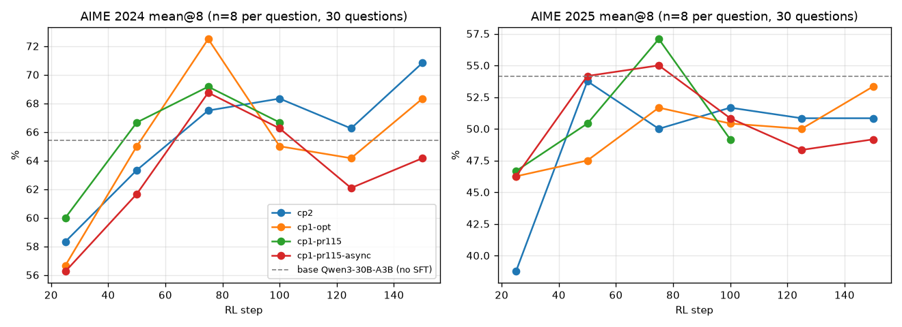
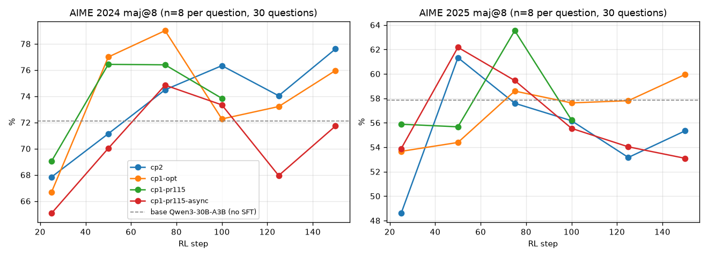
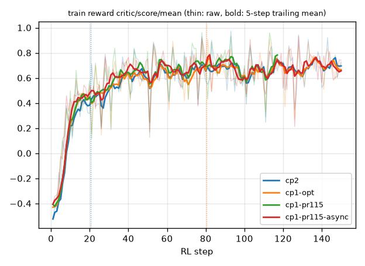
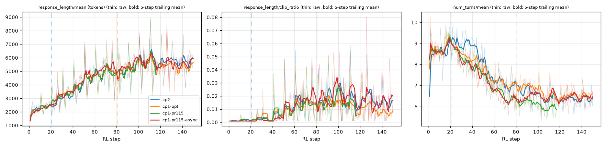
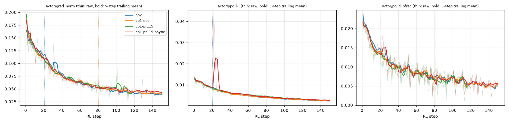
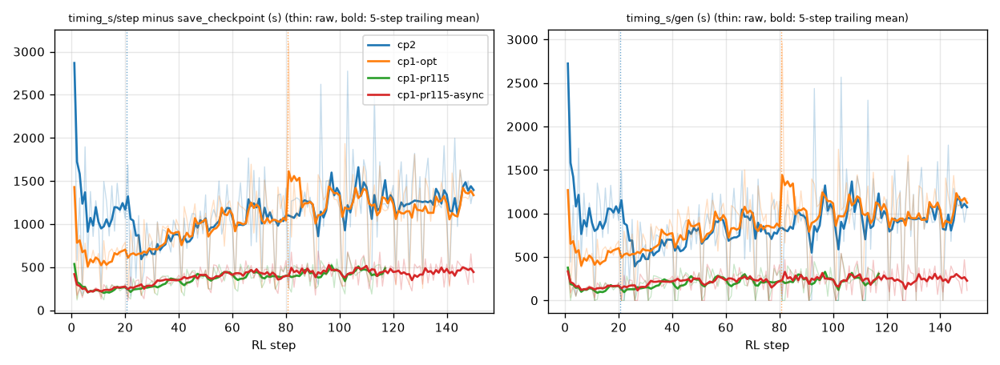
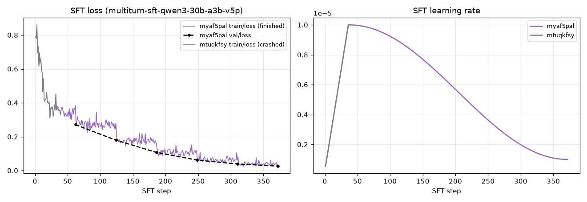
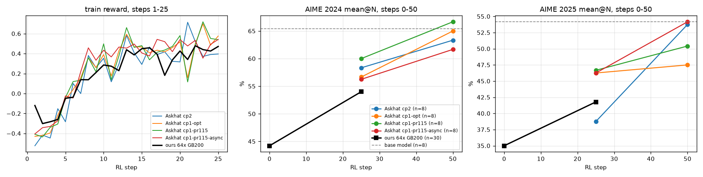

# Askhat TPU v5p ReTool 运行结果汇总

这里整理了 Askhat 在 TPU v5p 上跑的全部 ReTool 结果（Qwen3-30B-A3B，16K 响应长度 + thinking + shaped reward），用作我们 GB200 / TPU7x 64 卡对齐时的参照。

- **数据来源**：W&B 项目 `google-trellis/verl-torchtpu-grpo-test` 里名称包含 `v5p` 的全部 run，共 22 个，抓取时间见 [`askhat_v5p_runs.json`](askhat_v5p_runs.json) 的 `fetched_at_utc`。`yjowd03u` 只有 Step 0，按要求没有纳入。
- **生成方式**：数据由 [`fetch_askhat_v5p.py`](fetch_askhat_v5p.py) 通过 W&B API 抓取；下面所有表格和图都由 [`plot_askhat_v5p.py`](plot_askhat_v5p.py) 从这份 JSON 生成，`--check README.md` 会校验表格与数据一致。文中引用的数字都来自这些表格。

## 结论速览

1. **四条 RL 线记录了相同的 SFT 路径和部分关键超参**（§2）；checkpoint 内容尚未核对。它们的并行方式、部分资源规模和代码包不同，部分 run 的恢复关系也是推断（§2.3）。reward 曲线走势接近（§4），但不能当作同配置的四次独立重复来估计噪声。
2. **评估结果**（每题采样 8 次，AIME 每年 30 题）：Step 25 时 AIME 2024 在 56–60%，AIME 2025 在 39–47%。Step 50 之后不再明显上升，基本在 base 模型（没做 SFT 的原始 Qwen3-30B-A3B）附近波动。具体数字见 §3 的“关键数字”。
3. **评估结果有明显的观察波动**：Step 25 四条线之间的极差，AIME 2024 是 3.75 pp，AIME 2025 是 7.92 pp。同一条线相邻两个评估点也能差 7–8 pp，例如 `cp1-opt` 的 AIME 2024 从 step 75 到 100 是 72.50% → 65.00%，`cp1-pr115` 的 AIME 2025 从 step 75 到 100 是 57.08% → 49.17%。这些差异混合了训练、配置、恢复和评估采样的影响，不能直接作为评估噪声或 parity 容差。
4. **训练动态**：训练 reward 在前 25 步从约 −0.3 升到 +0.48，之后缓慢升到 +0.66–0.70；平均响应长度从约 2K token 涨到约 5.7–6.0K token；`num_turns/mean` 从约 8.6 降到约 6.5。
5. **速度**：不同运行记录的步时差异较大，无法仅凭这些 run 归因于并行方式。扣掉 checkpoint 保存时间后，`cp1-pr115` 和 `cp1-pr115-async` 每步约 250–455 s，`cp2` 和 `cp1-opt` 每步约 660–1,400 s。配置为同步保存 model + optimizer + extra 的运行，记录的单次保存耗时约 1,400 s。开了 `async_save` 的 `zyrnkte8` 每次只阻塞约 55 s，但它跑的代码和其他 run 不同，在我们的 fork 里只设 `async_save=True` 得不到这个效果，反而会让自动恢复失效（§2.4）。
6. **与我们的对照**（§6，仅供参考）：我们 GB200 64 卡 25 步的 run（用我们自己的 SFT，每题采样 30 次）在 Step 25 是 AIME 2024 54.00% / AIME 2025 41.78%。AIME 2025 落在 Askhat 四条线的范围内；AIME 2024 比范围下限低 2.25 pp。不同 run 的配置、checkpoint 和采样数尚未严格对齐，这个数值差异不能单独作为 parity 判断。

## 1. Run 总览

<!-- BEGIN AUTO-GENERATED inventory (plot_askhat_v5p.py) -->
| W&B run | 名称 | 类型 | 状态 | 记录的步数 | 创建时间 (UTC) | 备注 |
| --- | --- | --- | --- | --- | --- | --- |
| [`ej3qadj0`](https://wandb.ai/google-trellis/verl-torchtpu-grpo-test/runs/ej3qadj0) | `v5p-sweep-sft-a1-cp4` | SFT 吞吐 sweep | finished | – | 2026-10-28 20:42 |  |
| [`6qje08i7`](https://wandb.ai/google-trellis/verl-torchtpu-grpo-test/runs/6qje08i7) | `v5p-sweep-sft-a2-cp1` | SFT 吞吐 sweep | finished | – | 2026-10-28 20:43 |  |
| [`01j4ognl`](https://wandb.ai/google-trellis/verl-torchtpu-grpo-test/runs/01j4ognl) | `v5p-sweep-sft-a1-cp4` | SFT 吞吐 sweep | finished | – | 2026-10-28 20:48 |  |
| [`uy9p7zzm`](https://wandb.ai/google-trellis/verl-torchtpu-grpo-test/runs/uy9p7zzm) | `v5p-sweep-sft-a2-cp1` | SFT 吞吐 sweep | finished | – | 2026-10-28 20:48 |  |
| [`gqhabxy0`](https://wandb.ai/google-trellis/verl-torchtpu-grpo-test/runs/gqhabxy0) | `v5p-sweep-sft-a1-cp4` | SFT 吞吐 sweep | crashed | – | 2026-10-28 20:53 |  |
| [`5sc39bvt`](https://wandb.ai/google-trellis/verl-torchtpu-grpo-test/runs/5sc39bvt) | `v5p-sweep-sft-a2-cp1` | SFT 吞吐 sweep | finished | 1–2 | 2026-10-28 20:53 |  |
| [`gi9ovjym`](https://wandb.ai/google-trellis/verl-torchtpu-grpo-test/runs/gi9ovjym) | `v5p-sweep-sft-a2-cp1` | SFT 吞吐 sweep | crashed | 1–3 | 2026-10-28 21:06 |  |
| [`5wz1tm8x`](https://wandb.ai/google-trellis/verl-torchtpu-grpo-test/runs/5wz1tm8x) | `v5p-sweep-sft-a2-cp1` | SFT 吞吐 sweep | finished | 1–15 | 2026-10-28 21:28 |  |
| [`rh3uj51k`](https://wandb.ai/google-trellis/verl-torchtpu-grpo-test/runs/rh3uj51k) | `v5p-sweep-sft-a1-cp4` | SFT 吞吐 sweep | finished | 1–15 | 2026-10-28 21:36 |  |
| [`062uydgx`](https://wandb.ai/google-trellis/verl-torchtpu-grpo-test/runs/062uydgx) | `v5p-sweep-sft-a3-cp1-dynbsz` | SFT 吞吐 sweep | crashed | 1–11 | 2026-10-28 21:53 |  |
| [`fdx3ro0k`](https://wandb.ai/google-trellis/verl-torchtpu-grpo-test/runs/fdx3ro0k) | `retool-eval-base-qwen3-30b-a3b-v5p` | base 模型评估 | crashed | – | 2026-10-28 23:26 | base 模型评估的第一次尝试，无指标 |
| [`mtuqkfsy`](https://wandb.ai/google-trellis/verl-torchtpu-grpo-test/runs/mtuqkfsy) | `multiturn-sft-qwen3-30b-a3b-v5p` | SFT | crashed | 1–39 | 2026-10-29 00:31 | 同名 SFT 的第一次尝试，39 步后 crashed |
| [`myaf5pal`](https://wandb.ai/google-trellis/verl-torchtpu-grpo-test/runs/myaf5pal) | `multiturn-sft-qwen3-30b-a3b-v5p` | SFT | finished | 1–372 | 2026-10-29 00:47 | RL 的 `model_path` 与这个 SFT 实验同名（按名称对应，未核对 checkpoint 哈希） |
| [`4fl4zl1d`](https://wandb.ai/google-trellis/verl-torchtpu-grpo-test/runs/4fl4zl1d) | `retool-eval-base-qwen3-30b-a3b-v5p-n8` | base 模型评估 | finished | 0–0 | 2026-10-29 01:54 | 原始 `Qwen3-30B-A3B`（无 SFT），`val_only`，`n=8` |
| [`5lo8ruji`](https://wandb.ai/google-trellis/verl-torchtpu-grpo-test/runs/5lo8ruji) | `retool-dapo-qwen3-30b-a3b-v5p-cp2` | RL | failed | 1–1 | 2026-10-29 07:51 | 只记录了 step 1 |
| [`fcze3xlx`](https://wandb.ai/google-trellis/verl-torchtpu-grpo-test/runs/fcze3xlx) | `retool-dapo-qwen3-30b-a3b-v5p-cp2` | RL | crashed | 1–23 | 2026-10-29 09:39 |  |
| [`ci0k54pl`](https://wandb.ai/google-trellis/verl-torchtpu-grpo-test/runs/ci0k54pl) | `retool-dapo-qwen3-30b-a3b-v5p-cp2` | RL | finished | 21–150 | 2026-10-29 21:18 | 推测从 `fcze3xlx` 的 step 20 checkpoint 恢复（见下文“恢复关系”） |
| [`rq1p980n`](https://wandb.ai/google-trellis/verl-torchtpu-grpo-test/runs/rq1p980n) | `retool-dapo-qwen3-30b-a3b-v5p-cp1-opt` | RL | crashed | 1–80 | 2026-10-30 23:47 |  |
| [`hsodvfgr`](https://wandb.ai/google-trellis/verl-torchtpu-grpo-test/runs/hsodvfgr) | `retool-dapo-qwen3-30b-a3b-v5p-cp1-opt` | RL | finished | 81–150 | 2026-11-01 00:09 | 推测从 `rq1p980n` 的 step 80 checkpoint 恢复（见下文“恢复关系”） |
| [`yrcsp4z6`](https://wandb.ai/google-trellis/verl-torchtpu-grpo-test/runs/yrcsp4z6) | `retool-dapo-qwen3-30b-a3b-v5p-cp1-pr115` | RL | crashed | 1–117 | 2026-11-03 09:17 |  |
| [`zyrnkte8`](https://wandb.ai/google-trellis/verl-torchtpu-grpo-test/runs/zyrnkte8) | `retool-dapo-qwen3-30b-a3b-v5p-cp1-pr115-async` | RL | finished | 1–150 | 2026-11-04 02:39 |  |
<!-- END AUTO-GENERATED inventory -->

- 四条 RL 线按 W&B 名称后缀区分：`cp2`、`cp1-opt`、`cp1-pr115`、`cp1-pr115-async`。
- `cp2` 和 `cp1-opt` 中途 crash 后疑似从 checkpoint 恢复，按记录的 step 拼接成一条曲线（§2.3）。`yrcsp4z6`（`cp1-pr115`）在 step 117 crash，之后没有恢复；同配置加异步 checkpoint 保存的 `zyrnkte8`（`cp1-pr115-async`）完整跑完了 150 步。
- SFT 吞吐 sweep（`v5p-sweep-sft-*`）只是测吞吐，没有评估指标，后面不再展开。

## 2. 配置

### 2.1 四条 RL 线共享的配置

<!-- BEGIN AUTO-GENERATED shared (plot_askhat_v5p.py) -->
| 配置项 | 值 |
| --- | --- |
| SFT 起点 `actor_rollout_ref.model.path` | `/tmp/models/multiturn-sft-qwen3-30b-a3b-v5p` |
| 训练集 `data.train_files` | `/data/jialei/dataset/BytedTsinghua-SIA/DAPO-Math-17k` |
| 验证集 `data.val_files` | `/data/jialei/dataset/yentinglin/aime_2025, /data/jialei/dataset/Maxwell-Jia/AIME_2024` |
| `enable_thinking` | `True` |
| `max_prompt_length` | `2048` |
| `max_response_length` | `16384` |
| `max_assistant_turns` | `16` |
| `max_user_turns` | `16` |
| reward 函数 | `pkg://examples.tpu.retool.retool_tpu` |
| `train_batch_size`（prompts） | `64` |
| `ppo_mini_batch_size` | `64` |
| 每个 prompt 的 rollout 数 `n` | `16` |
| 训练 rollout temperature | `1` |
| 验证每题采样数 `val_kwargs.n` | `8` |
| 验证 temperature | `1` |
| 验证 top_p | `0.6` |
| actor lr | `2e-06` |
| `optim.clip_grad` | `0.0625` |
| `policy_loss.loss_mode` | `bypass_mode` |
| `rollout_correction.bypass_mode` | `True` |
| `rollout_correction.rollout_is` | `token` |
| `trainer.use_v1` | `True` |
| `v1.separate_async.num_warmup_batches` | `2` |
| `v1.sampler.max_off_policy_threshold` | `4` |
| `total_training_steps` | `150` |
| `test_freq` | `25` |
| `save_freq` | `10` |
| `val_before_train` | `False` |
| `resume_mode` | `auto` |
<!-- END AUTO-GENERATED shared -->

### 2.2 各条线的差异

<!-- BEGIN AUTO-GENERATED config (plot_askhat_v5p.py) -->
| 线 | W&B runs | trainer 芯片 | rollout 芯片 | trainer CP | trainer DP shard | 每芯片 token 上限 | rollout TP | rollout EP | rollout DP | max_num_seqs | 异步 ckpt 保存 | Ray 代码包 |
| --- | --- | --- | --- | --- | --- | --- | --- | --- | --- | --- | --- | --- |
| `cp2` | `fcze3xlx` → `ci0k54pl` | `16` | `16` → `32` | `2` | `8` | `9216` | `16` | `16` | `1` | `512` | `False` | `135b941c` → `f153e320` |
| `cp1-opt` | `rq1p980n` → `hsodvfgr` | `16` | `32` | `1` | `16` | `20480` | `16` | `16` | `1` | `512` | `False` | `3e59eec8` |
| `cp1-pr115` | `yrcsp4z6` | `16` | `32` | `1` | `16` | `20480` | `4` | `32` | `8` | `256` | `False` | `2bf15592` |
| `cp1-pr115-async` | `zyrnkte8` | `16` | `32` | `1` | `16` | `20480` | `4` | `32` | `8` | `256` | `True` | `fbcc65e0` |
<!-- END AUTO-GENERATED config -->

- 芯片数 = 主机数 × 每台主机 4 颗芯片（`trainer.nnodes × trainer.n_gpus_per_node`，rollout 同理）。除 `fcze3xlx`（rollout 16 颗）外，都是 trainer 16 颗 + rollout 32 颗 = 48 颗 v5p。
- `cp2` 恢复时把 rollout 从 16 颗换成了 32 颗（`fcze3xlx` → `ci0k54pl`），所以 `cp2` 前 20 步明显比之后慢（§4 的速度表）。
- 从名字看，`pr115` 对应 jialei777/verl-upstream#115（v5p trainer 性能优化：Tokamax fused log-prob、rollout DP、async all-gather）。这个对应关系是按名称推断的。配置里能看到的差异是：rollout 从 TP16 改成 TP4 × DP8（EP32），`max_num_seqs` 从 512 改成 256。
- 记录的配置中，`-async` 相比 `cp1-pr115` 增加了 `actor.checkpoint.async_save=True`；两者代码包不同，具体代码差异未知。
- “Ray 代码包”是 `PYTHONPATH` 里 Ray `working_dir` 包哈希的前 8 位。Ray 按上传的代码内容算这个哈希，内容变了哈希就变。W&B 没有记录 git commit，所以只能看出各 run 的代码是否相同，看不出具体改了什么：
  - `cp2` 恢复前后的代码不同。
  - `cp1-opt` 恢复前后的代码相同。
  - `cp1-pr115` 和 `cp1-pr115-async` 的代码不同。

### 2.3 恢复关系

<!-- BEGIN AUTO-GENERATED resume (plot_askhat_v5p.py) -->
| 线 | 前一段 run（记录的步数） | 恢复后的 run（记录的步数） | 共同的 `default_local_dir` | `resume_mode` / `save_freq` |
| --- | --- | --- | --- | --- |
| `cp2` | `fcze3xlx`（1–23，crashed） | `ci0k54pl`（21–150，finished） | `/data/aaskhat/checkpoint/retool-dapo-qwen3-30b-a3b-v5p-cp2` | `auto` / `10` |
| `cp1-opt` | `rq1p980n`（1–80，crashed） | `hsodvfgr`（81–150，finished） | `/data/aaskhat/checkpoint/retool-dapo-qwen3-30b-a3b-v5p-cp1-opt` | `auto` / `10` |
<!-- END AUTO-GENERATED resume -->

两段 run 用的是同一个 `default_local_dir`，并且都设置了 `resume_mode=auto` 和 `save_freq=10`。后一段 run 记录的第一步紧接在前一段最后一个 10 的倍数之后（21 和 81），因此推测它是从 step 20 / step 80 的 checkpoint 恢复的；尚未核对恢复日志或 checkpoint 指纹。`fcze3xlx` 记录的 21–23 步被 `ci0k54pl` 重新跑过，画曲线时 `cp2` 用的是 `fcze3xlx` 的 1–20 步加 `ci0k54pl` 的 21–150 步。

### 2.4 Checkpoint 保存

<!-- BEGIN AUTO-GENERATED ckpt (plot_askhat_v5p.py) -->
| 线 | W&B run | `save_freq` | `save_contents` / `load_contents` | `async_save` | 保留个数 | 保存次数 | `timing_s/save_checkpoint` 均值（最小–最大，秒） | 保存耗时 / wall time |
| --- | --- | --- | --- | --- | --- | --- | --- | --- |
| `cp2` | `fcze3xlx` | `10` | `['model', 'optimizer', 'extra']` / `['model', 'optimizer', 'extra']` | `False` | `2` | 2 | `1,390.2`（`1,349.8`–`1,430.7`） | `10.5%` |
| `cp2` | `ci0k54pl` | `10` | `['model', 'optimizer', 'extra']` / `['model', 'optimizer', 'extra']` | `False` | `2` | 13 | `1,429.4`（`1,367.5`–`1,539.9`） | `10.8%` |
| `cp1-opt` | `rq1p980n` | `10` | `['model', 'optimizer', 'extra']` / `['model', 'optimizer', 'extra']` | `False` | `2` | 8 | `1,411.8`（`1,389.4`–`1,435.8`） | `13.5%` |
| `cp1-opt` | `hsodvfgr` | `10` | `['model', 'optimizer', 'extra']` / `['model', 'optimizer', 'extra']` | `False` | `2` | 7 | `1,413.6`（`1,384.3`–`1,443.2`） | `10.0%` |
| `cp1-pr115` | `yrcsp4z6` | `10` | `['model', 'optimizer', 'extra']` / `['model', 'optimizer', 'extra']` | `False` | `2` | 11 | `1,398.9`（`1,363.3`–`1,441.2`） | `25.6%` |
| `cp1-pr115-async` | `zyrnkte8` | `10` | `['model', 'optimizer', 'extra']` / `['model', 'optimizer', 'extra']` | `True` | `2` | 15 | `55.2`（`46.3`–`60.4`） | `1.3%` |
<!-- END AUTO-GENERATED ckpt -->

- 所有 RL run 均配置为保存 model + optimizer + extra，保留最近 2 个；尚未核验各 checkpoint 的实际内容或异步保存后的恢复。配置为同步保存的 run 每次记录约 1,400 s。`yrcsp4z6` 每步本身只要 250–450 s，所以保存时间占到了它 wall time 的 25.6%。
- 开了 `async_save` 的 `zyrnkte8` 每次只阻塞约 55 s，占 wall time 1.3%。
- “保存耗时 / wall time”的分母是这个 run 第一条到最后一条 step 记录之间的时间，包含验证时间。

> [!WARNING]
> `zyrnkte8` 的约 55 s 不能直接照搬到我们这边：
>
> - **它跑的代码和 `yrcsp4z6` 不同。** 在 W&B 完整配置里，两者只有 8 个字段不同：`async_save`、实验名和相关路径、W&B telemetry，以及 Ray `working_dir` 包的哈希（`_ray_pkg_fbcc65e0b8e098c1` 对 `_ray_pkg_2bf155927c5ab5a2`）。Ray 按上传的代码内容算这个哈希，所以两次提交的代码不一样。W&B 里没有记录 git commit。
> - **在我们的 fork（`tpu-main` `c4726400`）里，只设 `async_save=True` 没用，还有副作用：**
>   - TorchTitan engine 不读 `async_save`：[`transformer_impl.py` L251-L257](https://github.com/syangx39/verl-upstream/blob/c4726400d1816939adf78ea26dd25f3b8d662ea3/verl/workers/engine/torchtitan/transformer_impl.py#L251-L257) 里的 `CheckpointManager.Config` 没有设异步模式，保存仍然是同步的。
>   - V1 trainer 在 `async_save=True` 时不会写 `latest_checkpointed_iteration.txt`：[`trainer_base.py` L1044-L1054](https://github.com/syangx39/verl-upstream/blob/c4726400d1816939adf78ea26dd25f3b8d662ea3/verl/trainer/ppo/v1/trainer_base.py#L1044-L1054)。若没有已有 tracker，`resume_mode=auto` 会从头训练；若旧 tracker 仍存在，则可能恢复到旧 checkpoint：[`trainer_base.py` L889-L897](https://github.com/syangx39/verl-upstream/blob/c4726400d1816939adf78ea26dd25f3b8d662ea3/verl/trainer/ppo/v1/trainer_base.py#L889-L897)。
> - **`zyrnkte8` 没有发生过恢复**，所以它在 `async_save=True` 下能不能恢复也没有验证过。这一点需要和 Askhat 确认。

## 3. 评估结果

<!-- BEGIN AUTO-GENERATED eval (plot_askhat_v5p.py) -->
| 线 | Step（W&B run） | AIME 2024 mean@8 | maj@8 | best@8 | AIME 2025 mean@8 | maj@8 | best@8 |
| --- | --- | --- | --- | --- | --- | --- | --- |
| base 模型（无 SFT） | 仅评估（`4fl4zl1d`） | `65.42%` | `72.11%` | `81.46%` | `54.17%` | `57.86%` | `70.61%` |
| `cp2` | 25（`ci0k54pl`） | `58.33%` | `67.84%` | `82.96%` | `38.75%` | `48.60%` | `63.24%` |
| `cp2` | 50（`ci0k54pl`） | `63.33%` | `71.15%` | `81.92%` | `53.75%` | `61.33%` | `77.18%` |
| `cp2` | 75（`ci0k54pl`） | `67.50%` | `74.50%` | `81.80%` | `50.00%` | `57.60%` | `71.63%` |
| `cp2` | 100（`ci0k54pl`） | `68.33%` | `76.34%` | `84.30%` | `51.67%` | `56.17%` | `73.34%` |
| `cp2` | 125（`ci0k54pl`） | `66.25%` | `74.04%` | `84.03%` | `50.83%` | `53.17%` | `75.15%` |
| `cp2` | 150（`ci0k54pl`） | `70.83%` | `77.61%` | `82.16%` | `50.83%` | `55.34%` | `71.47%` |
| `cp1-opt` | 25（`rq1p980n`） | `56.67%` | `66.68%` | `76.20%` | `46.25%` | `53.67%` | `71.00%` |
| `cp1-opt` | 50（`rq1p980n`） | `65.00%` | `77.00%` | `82.95%` | `47.50%` | `54.39%` | `72.17%` |
| `cp1-opt` | 75（`rq1p980n`） | `72.50%` | `79.01%` | `86.51%` | `51.67%` | `58.60%` | `72.06%` |
| `cp1-opt` | 100（`hsodvfgr`） | `65.00%` | `72.27%` | `85.73%` | `50.42%` | `57.63%` | `72.48%` |
| `cp1-opt` | 125（`hsodvfgr`） | `64.17%` | `73.22%` | `81.75%` | `50.00%` | `57.81%` | `76.15%` |
| `cp1-opt` | 150（`hsodvfgr`） | `68.33%` | `75.97%` | `82.00%` | `53.33%` | `59.95%` | `76.73%` |
| `cp1-pr115` | 25（`yrcsp4z6`） | `60.00%` | `69.04%` | `79.65%` | `46.67%` | `55.88%` | `68.42%` |
| `cp1-pr115` | 50（`yrcsp4z6`） | `66.67%` | `76.44%` | `84.13%` | `50.42%` | `55.67%` | `73.35%` |
| `cp1-pr115` | 75（`yrcsp4z6`） | `69.17%` | `76.40%` | `82.03%` | `57.08%` | `63.54%` | `79.08%` |
| `cp1-pr115` | 100（`yrcsp4z6`） | `66.67%` | `73.84%` | `84.69%` | `49.17%` | `56.23%` | `68.14%` |
| `cp1-pr115-async` | 25（`zyrnkte8`） | `56.25%` | `65.07%` | `82.08%` | `46.25%` | `53.88%` | `74.14%` |
| `cp1-pr115-async` | 50（`zyrnkte8`） | `61.67%` | `70.03%` | `81.10%` | `54.17%` | `62.18%` | `77.81%` |
| `cp1-pr115-async` | 75（`zyrnkte8`） | `68.75%` | `74.85%` | `86.91%` | `55.00%` | `59.46%` | `77.65%` |
| `cp1-pr115-async` | 100（`zyrnkte8`） | `66.25%` | `73.34%` | `83.05%` | `50.83%` | `55.55%` | `69.18%` |
| `cp1-pr115-async` | 125（`zyrnkte8`） | `62.08%` | `67.95%` | `81.42%` | `48.33%` | `54.04%` | `71.91%` |
| `cp1-pr115-async` | 150（`zyrnkte8`） | `64.17%` | `71.73%` | `84.64%` | `49.17%` | `53.10%` | `70.26%` |
<!-- END AUTO-GENERATED eval -->





**关键数字**

<!-- BEGIN AUTO-GENERATED summary (plot_askhat_v5p.py) -->
- AIME 2024 mean@8：Step 25 四条线 `56.25%`–`60.00%`（极差 `3.75` pp）；Step 50–150 全部 18 个评估点 `61.67%`–`72.50%`，均值 `66.48%`（最高 `72.50%`，`cp1-opt` step 75）；base 模型（无 SFT）`65.42%`。
- AIME 2025 mean@8：Step 25 四条线 `38.75%`–`46.67%`（极差 `7.92` pp）；Step 50–150 全部 18 个评估点 `47.50%`–`57.08%`，均值 `51.34%`（最高 `57.08%`，`cp1-pr115` step 75）；base 模型（无 SFT）`54.17%`。
- 训练 reward（5 步窗口均值）：steps 1–5 `-0.364`–`-0.275`，steps 21–25 `+0.479`–`+0.483`，steps 146–150 `+0.657`–`+0.696`（跑满 150 步的 3 条线）。
- `response_length/mean`（5 步窗口均值）：steps 1–5 `1,929`–`2,186`，steps 21–25 `2,557`–`2,930`，steps 146–150 `5,664`–`5,964`（跑满 150 步的 3 条线）。
- `num_turns/mean`（5 步窗口均值）：steps 1–5 `8.5`–`8.7`，steps 21–25 `8.7`–`8.9`，steps 146–150 `6.4`–`6.6`（跑满 150 步的 3 条线）。
<!-- END AUTO-GENERATED summary -->

- `mean@8` 是每题 8 次采样正确率的平均，再对 30 题取平均。`maj@8` 和 `best@8` 是 verl 对每题 8 个样本做 bootstrap 估计得到的多数投票正确率和 best-of-8 正确率（[`metric_utils.py` `process_validation_metrics`](https://github.com/syangx39/verl-upstream/blob/c4726400d1816939adf78ea26dd25f3b8d662ea3/verl/trainer/ppo/metric_utils.py#L1029-L1057)）。
- 所有 RL run 都设了 `val_before_train=False`，所以没有 Step 0（SFT 起点）的评估。唯一有 Step 0 的 `yjowd03u` 按要求没有纳入。
- 评估间隔是 25 步（`test_freq=25`）。验证时间不计入 `timing_s/step`，单独记在 `timing_s/testing`。

## 4. 训练曲线

<!-- BEGIN AUTO-GENERATED train (plot_askhat_v5p.py) -->
**训练 reward `critic/score/mean`**（5 步窗口均值；– 表示该窗口没有完整数据）

| 线 | Steps 1–5 | Steps 21–25 | Steps 46–50 | Steps 96–100 | Steps 146–150 |
| --- | --- | --- | --- | --- | --- |
| `cp2` | `-0.364` | `+0.479` | `+0.593` | `+0.619` | `+0.696` |
| `cp1-opt` | `-0.304` | `+0.483` | `+0.580` | `+0.619` | `+0.666` |
| `cp1-pr115` | `-0.306` | `+0.483` | `+0.651` | `+0.610` | – |
| `cp1-pr115-async` | `-0.275` | `+0.480` | `+0.653` | `+0.602` | `+0.657` |

**`response_length/mean`（token）**（5 步窗口均值；– 表示该窗口没有完整数据）

| 线 | Steps 1–5 | Steps 21–25 | Steps 46–50 | Steps 96–100 | Steps 146–150 |
| --- | --- | --- | --- | --- | --- |
| `cp2` | `2,186.1` | `2,556.6` | `4,178.7` | `5,689.0` | `5,964.0` |
| `cp1-opt` | `2,034.0` | `2,930.1` | `4,242.6` | `5,617.9` | `5,663.8` |
| `cp1-pr115` | `1,974.7` | `2,918.8` | `4,266.3` | `5,803.7` | – |
| `cp1-pr115-async` | `1,928.7` | `2,705.6` | `4,281.1` | `5,884.1` | `5,929.7` |

**`num_turns/mean`**（5 步窗口均值；– 表示该窗口没有完整数据）

| 线 | Steps 1–5 | Steps 21–25 | Steps 46–50 | Steps 96–100 | Steps 146–150 |
| --- | --- | --- | --- | --- | --- |
| `cp2` | `8.5` | `8.9` | `8.1` | `6.6` | `6.4` |
| `cp1-opt` | `8.6` | `8.8` | `7.6` | `6.8` | `6.6` |
| `cp1-pr115` | `8.6` | `8.7` | `7.5` | `6.2` | – |
| `cp1-pr115-async` | `8.7` | `8.8` | `7.6` | `6.6` | `6.5` |

**`timing_s/step` − `timing_s/save_checkpoint`（秒；扣掉 checkpoint 保存，验证本来不计入 step）**（5 步窗口均值；– 表示该窗口没有完整数据）

| 线 | Steps 1–5 | Steps 21–25 | Steps 46–50 | Steps 96–100 | Steps 146–150 |
| --- | --- | --- | --- | --- | --- |
| `cp2` | `1,368.8` | `872.5` | `1,066.9` | `1,357.3` | `1,396.0` |
| `cp1-opt` | `695.2` | `656.5` | `1,054.1` | `1,332.2` | `1,335.8` |
| `cp1-pr115` | `270.1` | `248.6` | `404.6` | `449.5` | – |
| `cp1-pr115-async` | `254.0` | `285.2` | `412.7` | `455.5` | `443.6` |
<!-- END AUTO-GENERATED train -->









- 细线是原始值，粗线是 5 步滑动平均。竖的虚线标出恢复点（`cp2` 在 step 20/21，`cp1-opt` 在 step 80/81）。
- `timing_s/step` 本身包含 checkpoint 保存时间。例如 `rq1p980n` 在 step 10 的 `timing_s/step` 是 2,058.7 s，其中 `timing_s/save_checkpoint` 占 1,399.4 s。所以上面的速度表和图 6 都扣掉了保存时间。

## 5. SFT

<!-- BEGIN AUTO-GENERATED sft (plot_askhat_v5p.py) -->
| W&B run | 状态 | 步数 | lr / warmup 比例 / epochs / batch | train/loss 首 → 末 | val/loss（最小 / 最后） |
| --- | --- | --- | --- | --- | --- |
| `myaf5pal` | finished | 1–372 | `1e-05` / `0.1` / `6` / `32` | `0.7914` → `0.0367` | `0.0266` / `0.0266` |
| `mtuqkfsy` | crashed | 1–39 | `1e-05` / `0.1` / `6` / `32` | `0.7914` → `0.3313` | – |
<!-- END AUTO-GENERATED sft -->



- SFT 从原始 `/tmp/models/Qwen3-30B-A3B` 开始，使用 ReTool-SFT 数据，`max_length=16384`，16 颗 v5p。
- SFT 的 `val_files` 和 `train_files` 是同一个 parquet 文件，所以这里的 `val/loss` 不是 held-out 指标。
- RL 的 `model_path`（`/tmp/models/multiturn-sft-qwen3-30b-a3b-v5p`）和这个 SFT 实验同名。这个对应关系是按名称推断的，没有核对 checkpoint 哈希，也不知道用的是哪一步的 checkpoint。

## 6. 与我们 64 卡 run 的对照（仅供参考）

<!-- BEGIN AUTO-GENERATED ours (plot_askhat_v5p.py) -->
| Run | 每题采样 `n` | Step 0 AIME 2024 / 2025 | Step 25 AIME 2024 / 2025 | 训练 reward steps 21–25 |
| --- | --- | --- | --- | --- |
| base 模型 `4fl4zl1d`（无 SFT） | 8 | `65.42%` / `54.17%` | – | – |
| Askhat `cp2` | 8 | –（未做 Step 0 评估） | `58.33%` / `38.75%` | `+0.479` |
| Askhat `cp1-opt` | 8 | –（未做 Step 0 评估） | `56.67%` / `46.25%` | `+0.483` |
| Askhat `cp1-pr115` | 8 | –（未做 Step 0 评估） | `60.00%` / `46.67%` | `+0.483` |
| Askhat `cp1-pr115-async` | 8 | –（未做 Step 0 评估） | `56.25%` / `46.25%` | `+0.480` |
| 我们 `g64-retool-25s-01`（64× GB200，我们自己的 SFT） | 30 | `44.22%` / `35.00%` | `54.00%` / `41.78%` | `+0.432` |
<!-- END AUTO-GENERATED ours -->



这不是严格对照，主要有四点不同：

1. **SFT 来源和路径不同**：我们用的是 `p2-retool-sft-01/global_step_372`，Askhat 记录的路径是 `multiturn-sft-qwen3-30b-a3b-v5p`；权重是否一致尚未通过 hash 对账。
2. **评估采样数不同**：我们每题采样 30 次，Askhat 采样 8 次。
3. **硬件不同**：我们是 GB200，Askhat 是 v5p。
4. **Askhat 没有 Step 0 评估**，所以没法比较各自从起点涨了多少。

我们 TPU7x 64 卡 25 步的 run（`p3c-retool-25s-02`）还在跑，结果会补在 PR #18 里。

## 7. 复现

```bash
cd examples/tpu/retool/results/askhat-v5p
# 重新抓取会覆盖当前快照；需要 W&B API key
WANDB_API_KEY=... python3 fetch_askhat_v5p.py --out askhat_v5p_runs.json
python3 plot_askhat_v5p.py --figures          # 需要 matplotlib
python3 plot_askhat_v5p.py --print-markdown   # 打印本文件中的自动生成表格
python3 plot_askhat_v5p.py --check README.md  # 校验本文件中的表格与 JSON 一致
```

## 8. 证据边界

- W&B history 按 `history(samples: 2000)` 抓取并过滤，只保留所需指标；快照中的步数覆盖范围见 §1。过滤后的行数不能证明原始 history 没有降采样。
- 有三处对应关系是按名称或记录的步数推断的，不是从 W&B 元数据直接读到的：恢复关系、SFT checkpoint 与 RL `model_path` 的对应、`pr115` 与 PR #115 的对应。
- W&B 没有记录 git commit 和镜像。各 run 提交的代码包（Ray `working_dir` 哈希）不完全相同，所以“配置相同”不等于“代码相同”。
- 快照之后 Askhat 新跑的 run 不在这里，重新运行 `fetch_askhat_v5p.py` 可以更新。
